# Signal Hoist: VAST Challenge 2023

An interactive visual-analytics response to the [IEEE VAST Challenge 2023](https://vast-challenge.github.io/2023/). The challenge is set in the fictional island nation of Oceanus, where the NGO FishEye International investigates illegal, unreported and unregulated (IUU) fishing. FishEye's data comes as three knowledge graphs: entities extracted from news by NLP, seven years of customs shipment records, and a corporate register. Each graph hides a structure that looks like evidence but is an artefact of how the data was made. The site separates the two with null models and states a confidence for every verdict. It tells each challenge as a scroll story on a "night sea", where the light comes only from the data, and every claim sits beside the interactive view that produced it.

**Live site:** https://amukherjee1991.github.io/Vast23/

**Written report and VAST answer sheets:** [submission/](submission/) ([combined PDF](submission/VAST2023-Signal-Hoist.pdf))

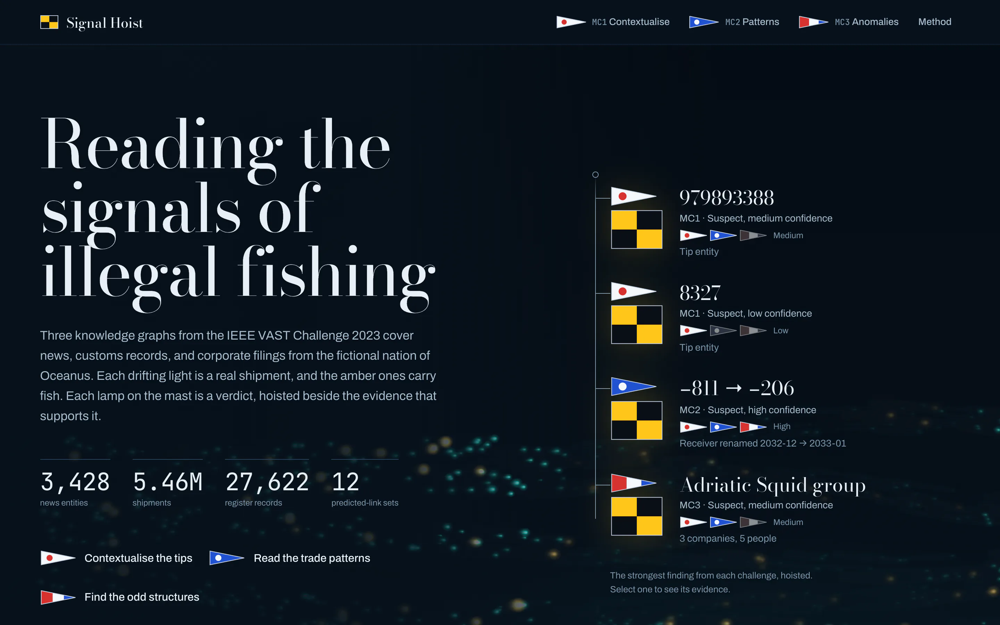

## Contents

- [The three challenges](#the-three-challenges)
- [How to read it](#how-to-read-it)
- [Home](#home)
- [MC1: a hidden layer of weak links](#mc1-a-hidden-layer-of-weak-links)
- [MC2: eight fish traders stop, then return under a new name](#mc2-eight-fish-traders-stop-then-return-under-a-new-name)
- [MC3: the giant network is a name collision](#mc3-the-giant-network-is-a-name-collision)
- [Method](#method)
- [Method summary](#method-summary)
- [Repository structure](#repository-structure)
- [Run it](#run-it)
- [Design](#design)
- [Limits and caveats](#limits-and-caveats)

## The three challenges

| | Challenge | Data | Headline finding |
|---|---|---|---|
| **MC1** | Contextualise four entities named in a tip | News-extracted knowledge graph: 3,428 entities, 11,069 relations | 88 low-weight links form a 79-node layer that random edges never produce (p = 0.001). Three of the four tipped entities sit inside it. |
| **MC2** | Find temporal patterns, judge 12 bundles of AI-predicted links, flag suspicious companies | Customs graph: 5.46M shipments, 34,576 companies, 2028–2034 | 5 of 12 link bundles hold up against the real trade records. 8 fish-trading pairs look like a firm shutting down and reopening under a new name. |
| **MC3** | Find anomalous business structures and group similar businesses | Corporate register: 27,622 nodes, 24,038 links | The 7,093-node "giant network" is mostly a common-name collision. The real anomalies are small fishing-named groups that share owners; 2 are Suspect. |

## How to read it

**The signal code.** Verdicts are flags from the International Code of Signals, chosen because their meanings at sea match the finding:

| Flag | Verdict | Meaning at sea |
|---|---|---|
| **L** | Suspect | "Stop your vessel instantly" |
| **U** | Possible | "You are running into danger" |
| **X** | Insufficient evidence | "Watch for my signals" |
| **N** | Unlikely | "Negative" |

**Numeral pennants** show confidence: one hoisted means low, two medium, three high. Each flag pairs a pattern with a colour, so the code reads in grayscale and for colour-blind readers. Confidence describes how solid the evidence is, not how bad the finding sounds.

**Keyboard.** On any page, **n** and **p** move to the next and previous chapter, and **0–4** jump straight to Home, MC1, MC2, MC3 or Method.

**Chapters.** Each challenge page has the same shape:

1. An **opener** with the headline claim and the strongest verdicts, hoisted as lamps.
2. A **scroll story**: a full-bleed stage pinned to the screen while six short steps scroll past and drive it.
3. The **official questions** (Q1…Qn), each answered with interactive evidence views. Every chart has a table view and names its source file.
4. A closing **bridge** to the next chapter.

## Home

The home page is the front door. It states the scenario in one paragraph and gives four headline counts: 3,428 news entities, 5.46M shipments, 27,622 register records and 12 predicted-link sets. A mast hoists the strongest finding from each challenge as a lit verdict flag, and selecting one opens its evidence. Behind the title, a field of drifting lights shows real shipments, with fish in amber. Below that are the three chapter links, each with its finding in one sentence, and the signal code.

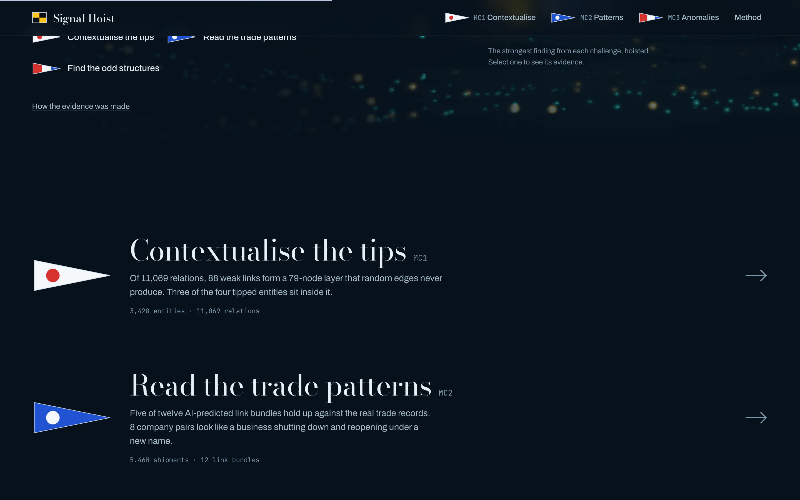

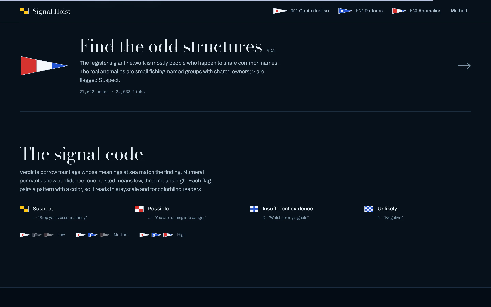

## MC1: a hidden layer of weak links

**What the page is for.** FishEye's tip names four entities: Mar de la Vida OJSC, 979893388, Oceanfront Oasis Inc Carriers and 8327. The page shows the context around each one in the news-extracted graph and says whether each can be tied to illegal fishing. It then ranks which other companies deserve a look.

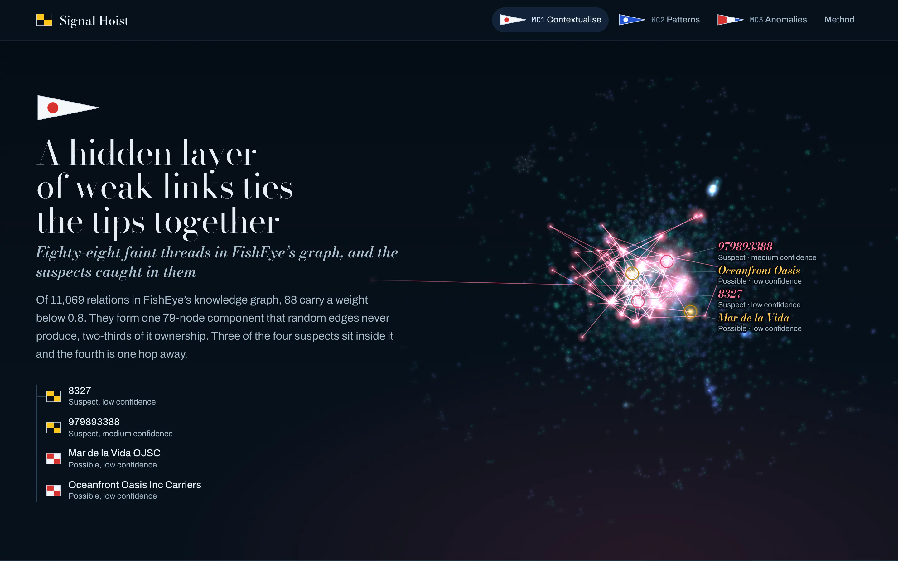

### The scroll story: a constellation

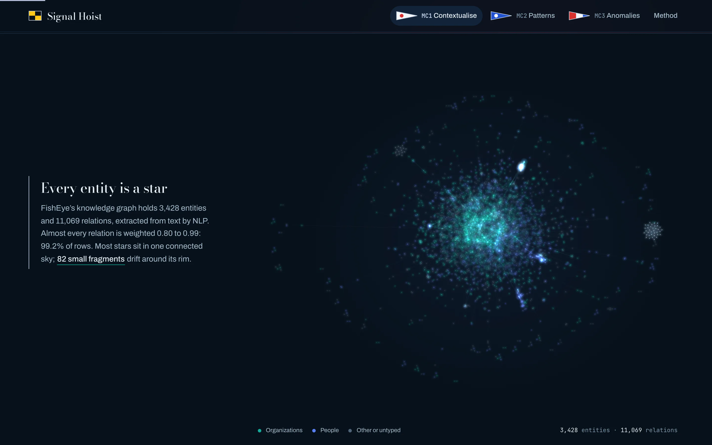
**1. Every entity is a star.** The graph holds 3,428 entities and 11,069 relations. 99.2% of the relations are weighted 0.80 to 0.99. Most stars sit in one connected sky, and 82 small fragments drift around its rim.

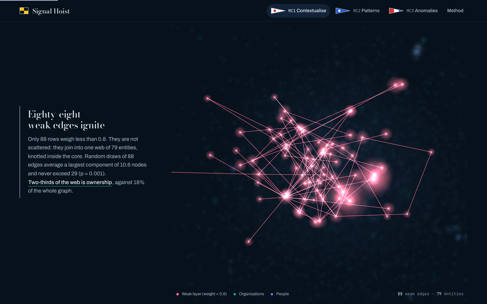
**2. Eighty-eight weak edges ignite.** Only 88 rows weigh less than 0.8, and they join into one web of 79 entities. Random draws of 88 edges average a largest component of 10.6 nodes and never exceed 29 (p = 0.001). Two-thirds of the web is ownership, against 18% of the whole graph.

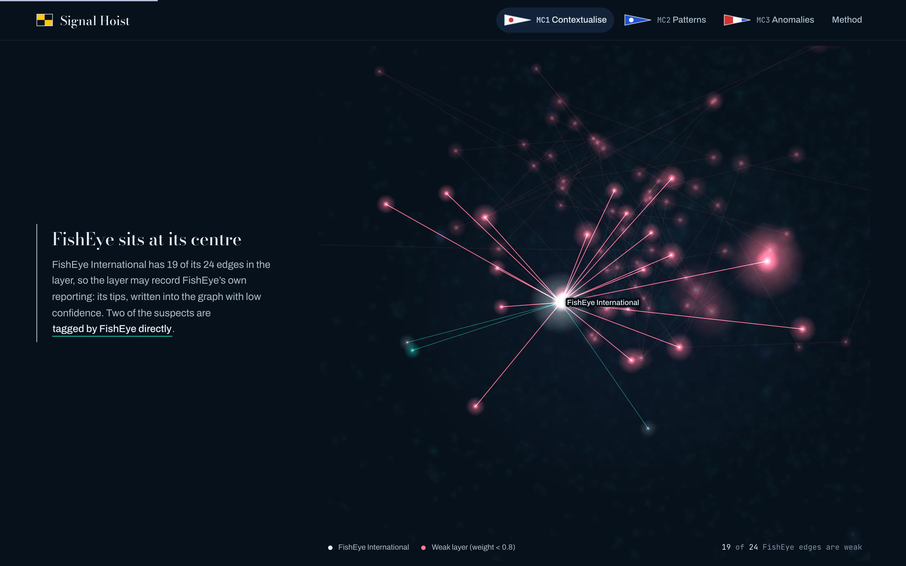
**3. FishEye sits at its centre.** 19 of FishEye International's 24 edges are in the layer, so the layer may record FishEye's own reporting, written into the graph with low confidence. Two suspects are tagged by FishEye directly.

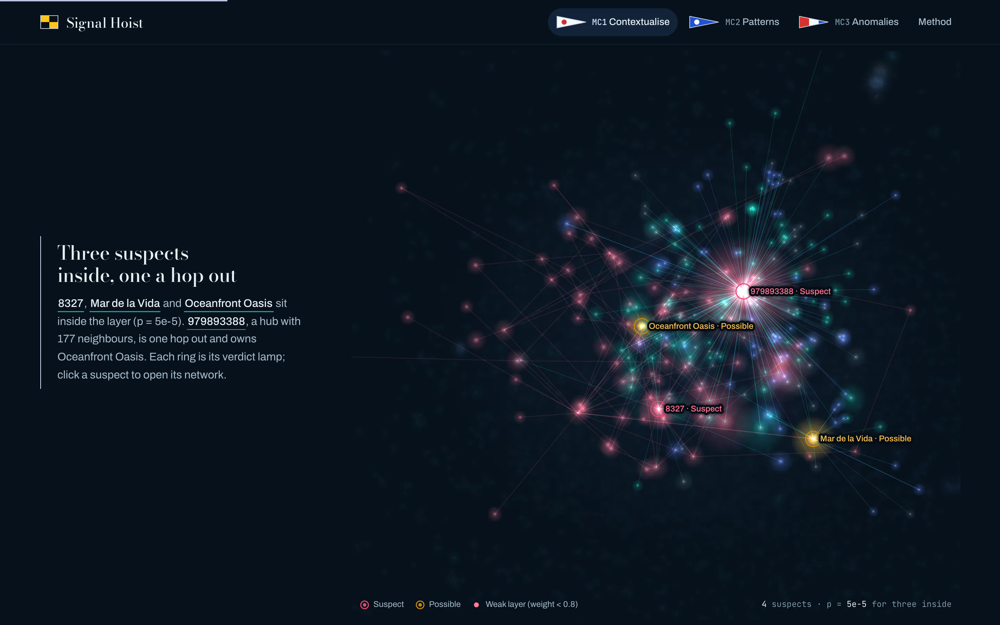
**4. Three suspects inside, one a hop out.** 8327, Mar de la Vida and Oceanfront Oasis sit inside the layer (p = 5e-5). 979893388, a hub with 177 neighbours, is one hop out and owns Oceanfront Oasis.

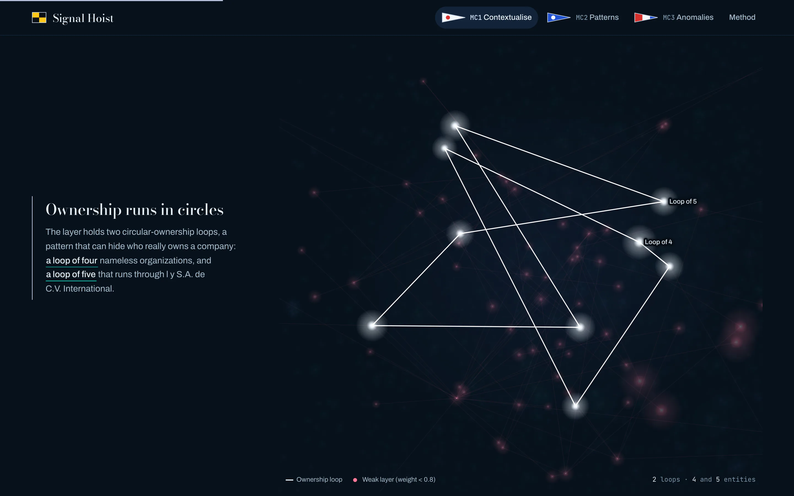
**5. Ownership runs in circles.** The layer holds two circular-ownership loops, a pattern that can hide who really owns a company. One is a loop of four nameless organizations; the other is a loop of five through "l y S.A. de C.V. International".

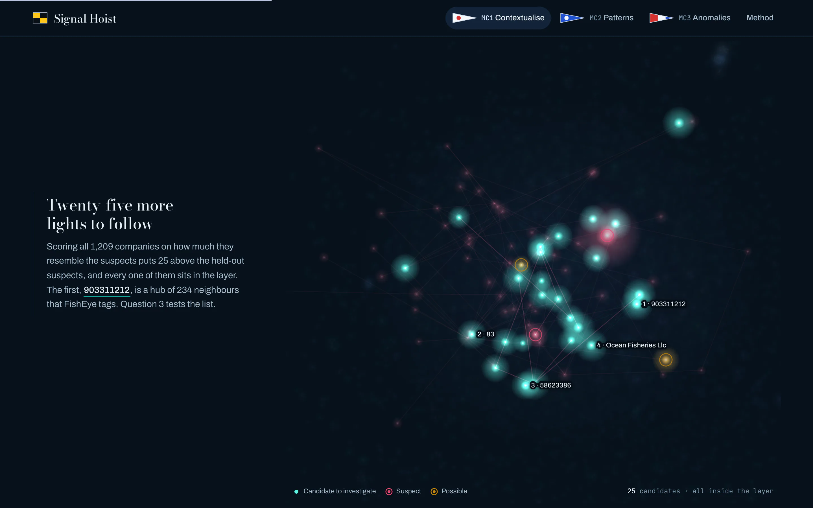
**6. Twenty-five more lights to follow.** Scoring all 1,209 companies on how much they resemble the suspects puts 25 above the held-out suspects, and every one of them sits in the layer. The first, 903311212, is a hub of 234 neighbours that FishEye tags.

### Evidence views

The questions below the story hold ego networks for each suspect (1 or 2 hops, weak edges dashed), the weight histogram with its null model, percentile and rubric views, the six-hop ownership chain, a distance null model, the ranked candidate list with an evidence subgraph for each candidate, and leave-one-out, ablation and data-quality checks.

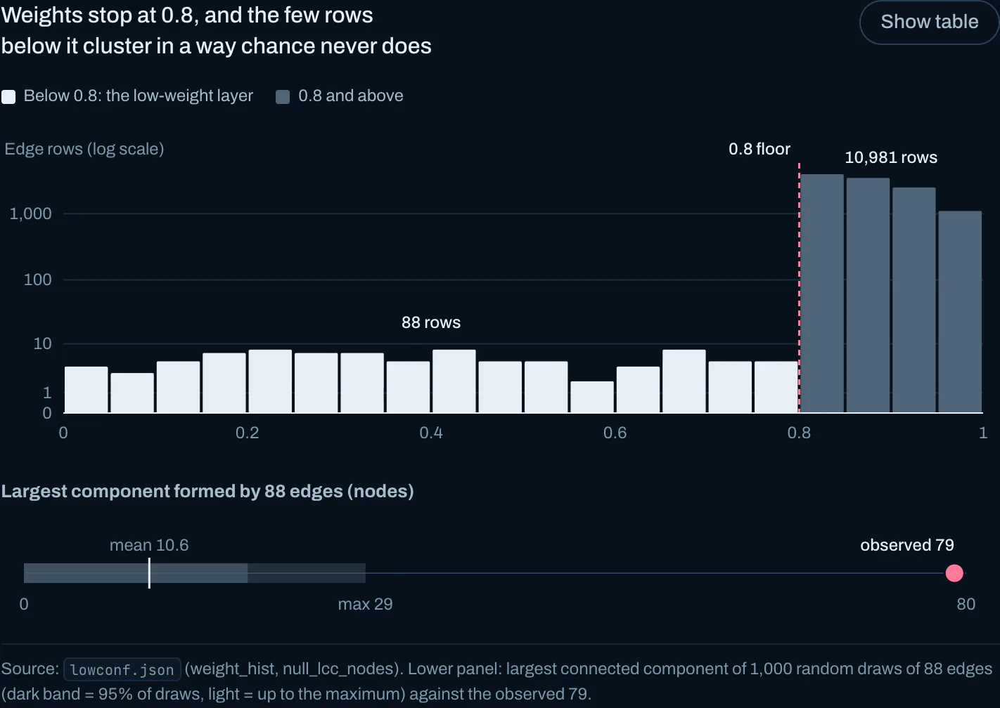

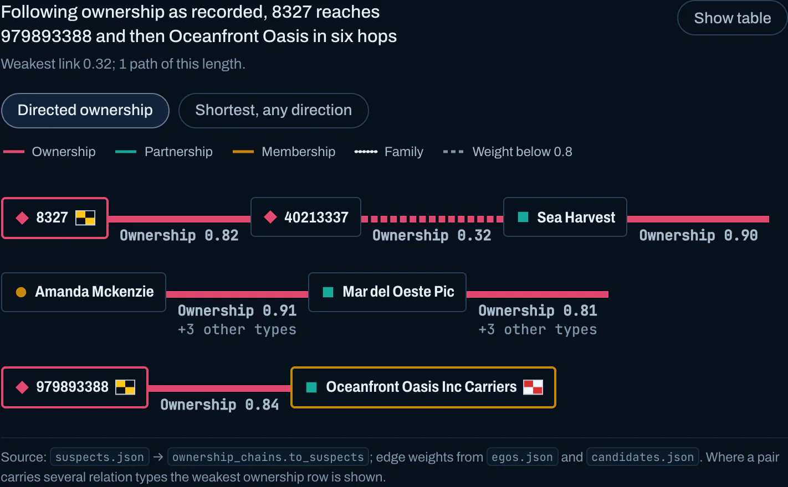

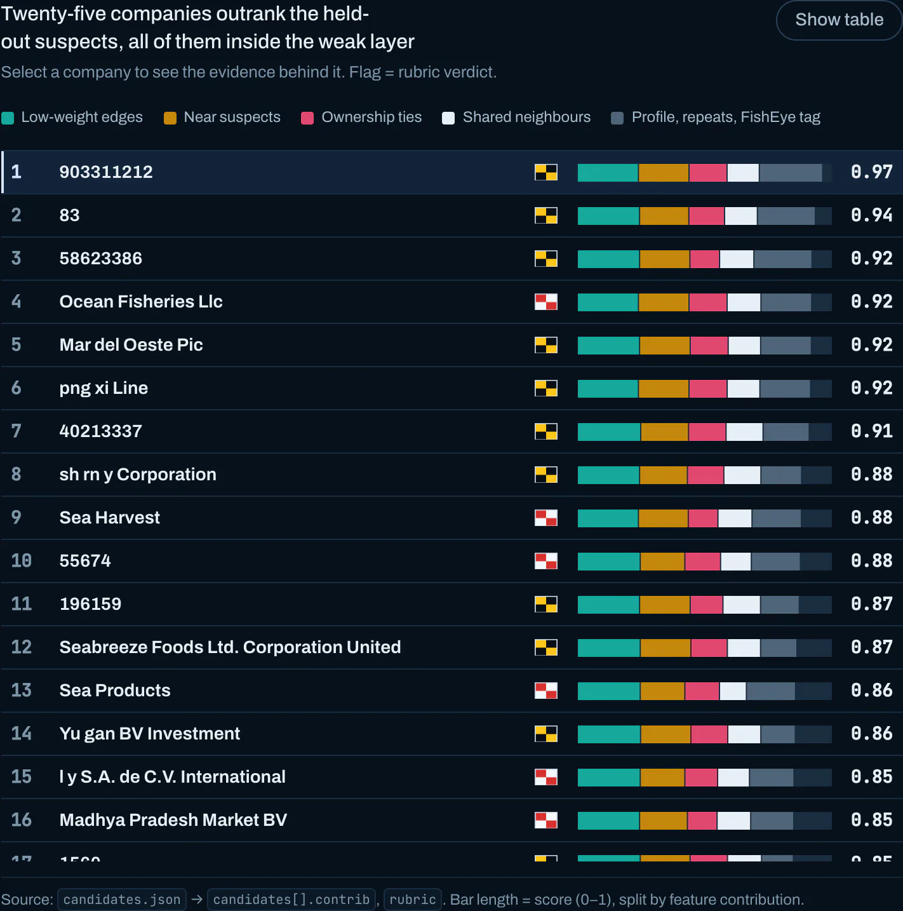

### Verdicts

| Entity | Verdict | Confidence | Why |
|---|---|---|---|
| 8327 | Suspect | Low | Strongest structural signature (5 rubric points). It is owned through a 0.12 edge by Seabreeze Foods, which FishEye tags, and it heads a six-hop ownership chain to two other suspects. Almost every signal rests on edges below 0.8. |
| 979893388 | Suspect | Medium | A hub at the 99.8th percentile of degree and betweenness that owns Oceanfront Oasis through a strong 0.84 edge. "ipoa-iuu" and "poached" lie two hops out. |
| Mar de la Vida OJSC | Possible | Low | Mostly people and memberships. It is tied to the layer only by a weak FishEye tag (0.46). |
| Oceanfront Oasis Inc Carriers | Possible | Low | Four incoming edges: a weak FishEye tag (0.45) and ownership by 979893388. A thin subsidiary. |

The candidates to investigate first are **#903311212** (rank 1; Suspect, medium confidence) and **#48** (rank 18; the only high-confidence candidate). Held out in turn, each suspect ranks in the top 4% of 1,210, where degree alone misses three of them. The ranking keeps a mean Spearman correlation of 0.98 across 300 reweightings.

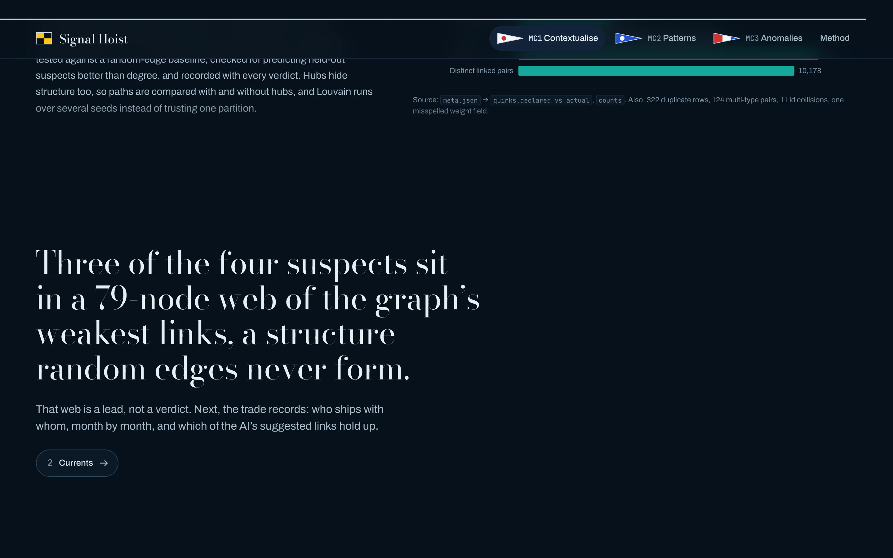

## MC2: eight fish traders stop, then return under a new name

**What the page is for.** MC2 finds temporal patterns in seven years of trade, decides which of FishEye's twelve AI-predicted link bundles can be trusted, shows what the trusted links change, and names the companies that fit an IUU pattern: a trader that goes quiet and comes back under a new name.

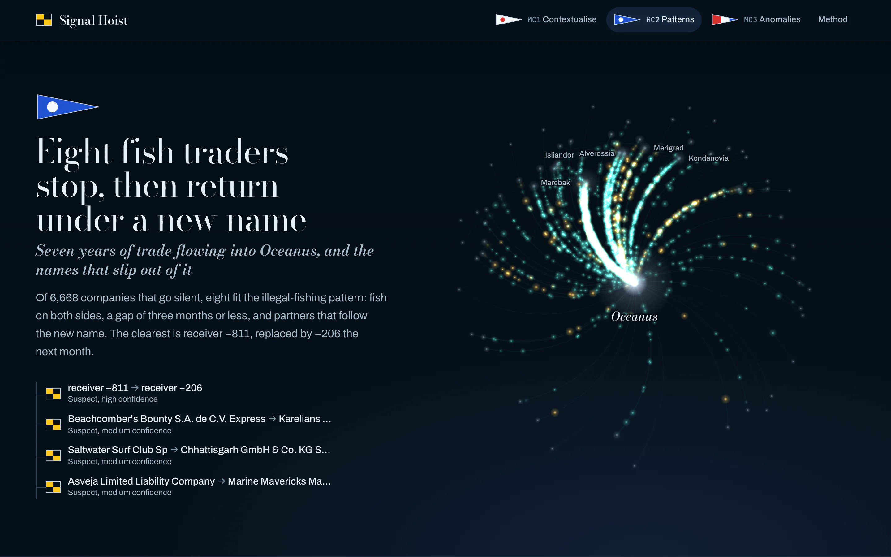

### The scroll story: currents

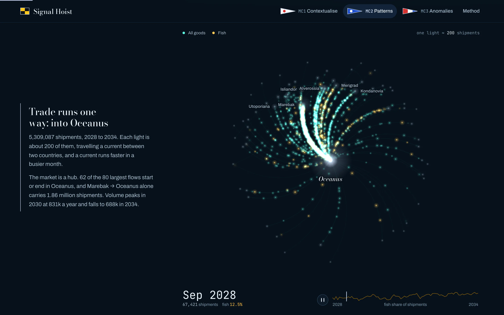
**1. Trade runs one way: into Oceanus.** 5,309,087 shipments from 2028 to 2034. Each light is about 200 of them, travelling a current between two countries. 62 of the 80 largest flows start or end in Oceanus, and Marebak → Oceanus alone carries 1.86 million shipments. Volume peaks in 2030 at 831k a year and falls to 688k in 2034.

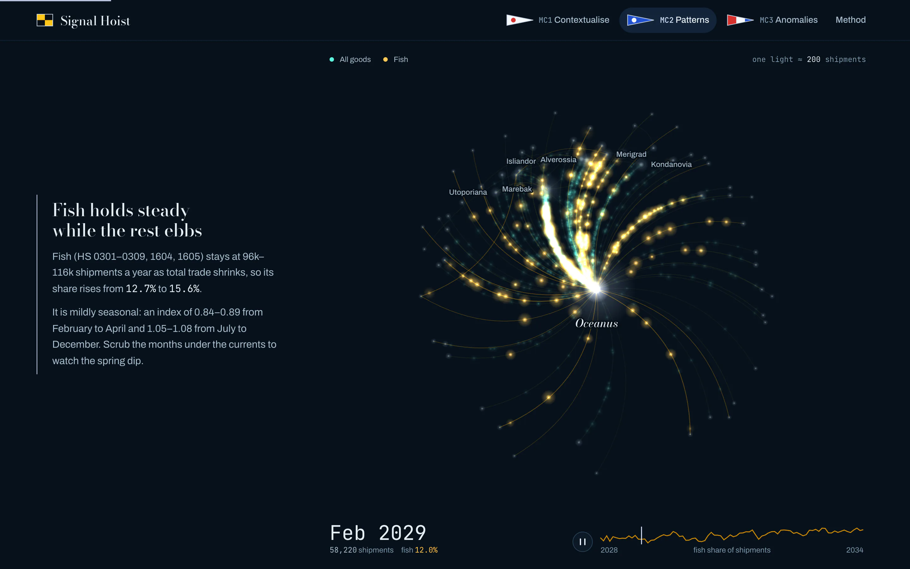
**2. Fish holds steady while the rest ebbs.** Fish (HS 0301–0309, 1604, 1605) stays at 96k–116k shipments a year as total trade shrinks, so its share rises from 12.7% to 15.6%. It is mildly seasonal: an index of 0.84–0.89 from February to April and 1.05–1.08 from July to December.


**3. Shippers stay lit; receivers flicker out.** Shippers are durable: a median span of 59 months, and 4,875 of 12,217 trade for 73–84 months. Receivers are fleeting: a median of 3 months, and 44% appear in a single month. 2,139 of 4,299 fish-majority shippers are transient.


**4. One buyer goes dark, another lights up.** Receiver −811 buys fillets until December 2032. In January 2033 receiver −206 starts buying the same goods from the same shippers: five of them switch over and supply 78% of its trade. Of 872 candidate handovers, eight are Suspect; this one is the clearest, with high confidence.

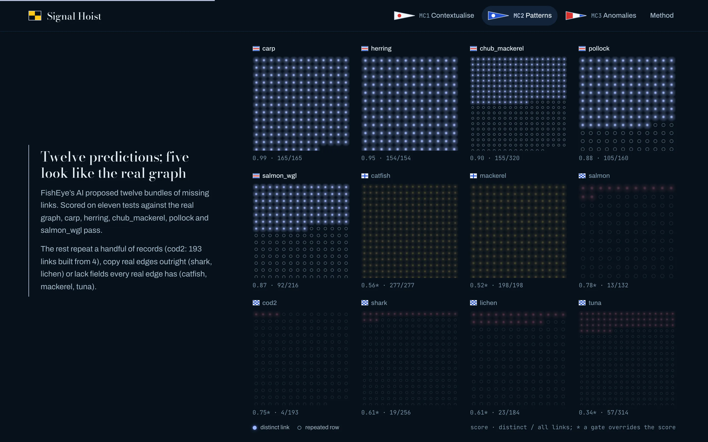
**5. Twelve predictions; five look like the real graph.** Scored on eleven tests against the real graph, carp, herring, chub_mackerel, pollock and salmon_wgl pass. The rest repeat a handful of records (cod2: 193 links built from 4), copy real edges outright (shark, lichen), or lack fields that every real edge has (catfish, mackerel, tuna).

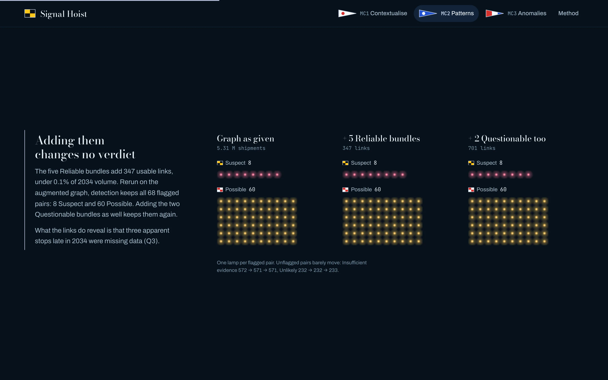
**6. Adding them changes no verdict.** The five Reliable bundles add 347 usable links, under 0.1% of 2034 volume. Rerun on the augmented graph, detection keeps all 68 flagged pairs (8 Suspect and 60 Possible), and it keeps them again when the two Questionable bundles are added too.

### Evidence views

The questions hold an eight-pattern taxonomy of 245,807 trading pairs, a look-alike gap profile, the bundle scorecard with a detail view for each bundle, the added-links and revived-stopper charts, a pattern-transition matrix, each successor pair's handover, and a data-quality summary.

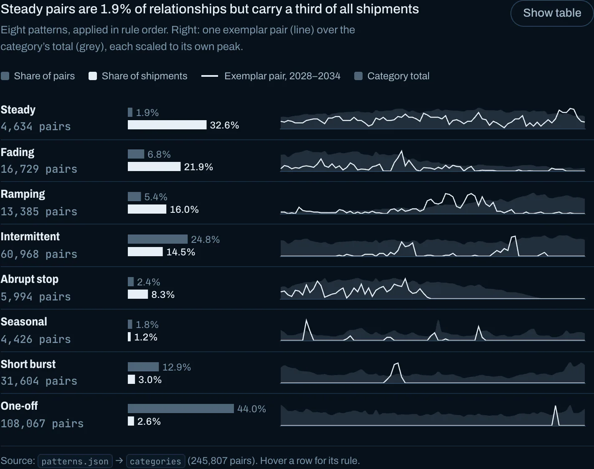


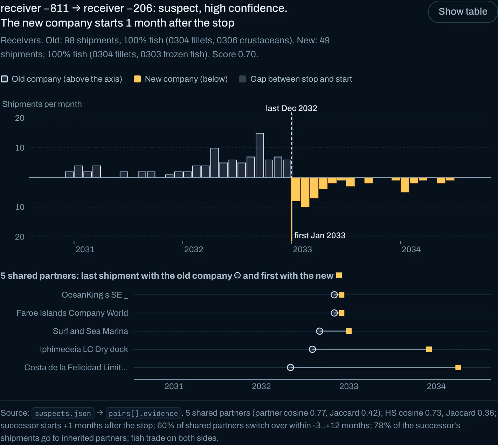

### Verdicts

| Entity | Verdict | Confidence | Why |
|---|---|---|---|
| receiver −811 → −206 | Suspect | High | Fillet buyer stops in Dec 2032; a new id starts in Jan 2033, and 5 shared shippers supply 78% of its trade |
| Beachcomber's Bounty S.A. de C.V. Express → Karelians Limited Liability Company International | Suspect | Medium | Karelians also succeeds five more fish shippers that stopped in 2030 |
| Saltwater Surf Club Sp → Chhattisgarh GmbH & Co. KG Sea spray | Suspect | Medium | Dried fish only; a two-month gap; all three shared partners switch |
| Asveja Limited Liability Company → Marine Mavericks Marine biology | Suspect | Medium | Molluscs; 95% of the successor's trade is inherited |
| receiver −812 → −556 | Suspect | Medium | Prepared crustaceans; 5 shared shippers |
| receiver −513 → −690 | Suspect | Medium | Identical partner set |
| The Salty Dog Corporation → Gulf of Guinea Sp | Suspect | Low | Small predecessor (13 shipments) |
| Estrella del Sol CJSC → Mandalore S.A. de C.V. Logistics | Suspect | Low | Small predecessor (12 shipments) |
| Bundles carp, herring | Reliable | High | Pass every realism test |
| Bundles chub_mackerel, pollock, salmon_wgl | Reliable | Medium | Realistic distinct links, unexplained repetition |
| Bundles catfish, mackerel | Questionable | Medium | No weights; dates past the data window |
| Bundles salmon, cod2, shark, lichen, tuna | Unreliable | High | Mass repetition, wholesale copies, or missing fields |

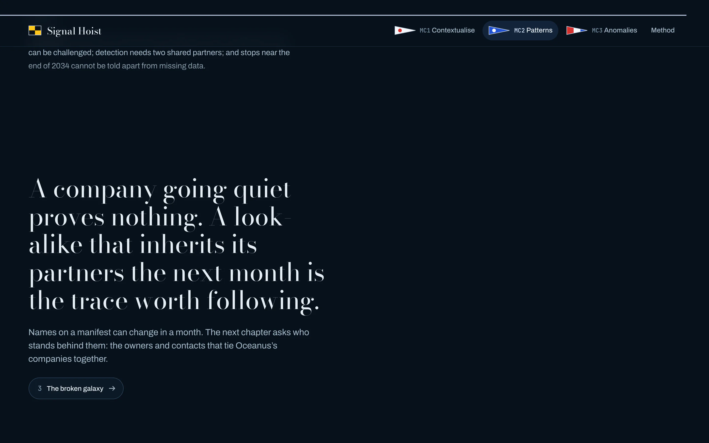

## MC3: the giant network is a name collision

**What the page is for.** MC3 finds anomalous business groups in FishEye's corporate register, groups similar businesses, says how confident each grouping is, and ranks which groups FishEye should investigate for illegal fishing.

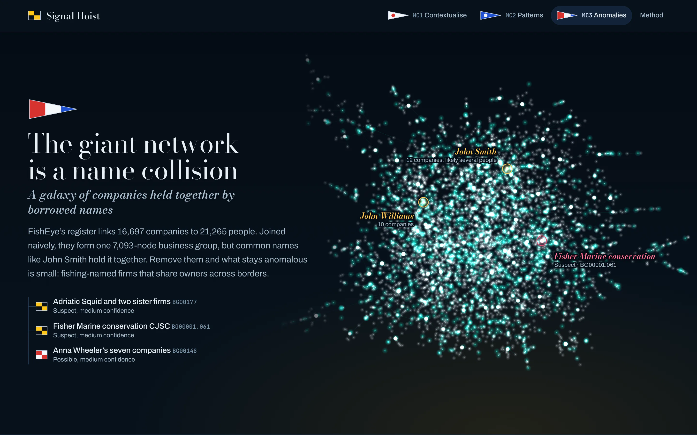

### The scroll story: the broken galaxy

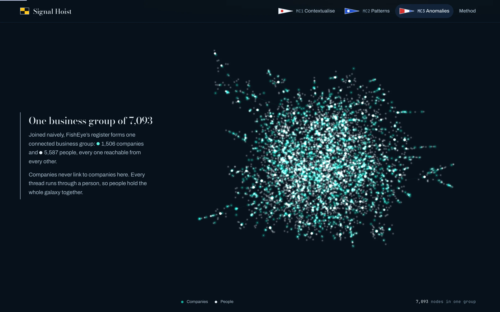
**1. One business group of 7,093.** Joined naively, the register forms one connected business group of 1,506 companies and 5,587 people. Companies never link to companies here; every thread runs through a person.

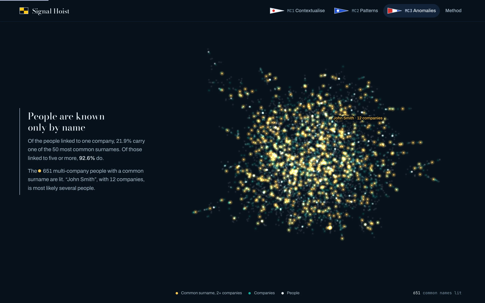
**2. People are known only by name.** 21.9% of people linked to one company carry one of the 50 most common surnames, against 92.6% of those linked to five or more. The 651 multi-company people with a common surname are lit. "John Smith", with 12 companies, is most likely several people.

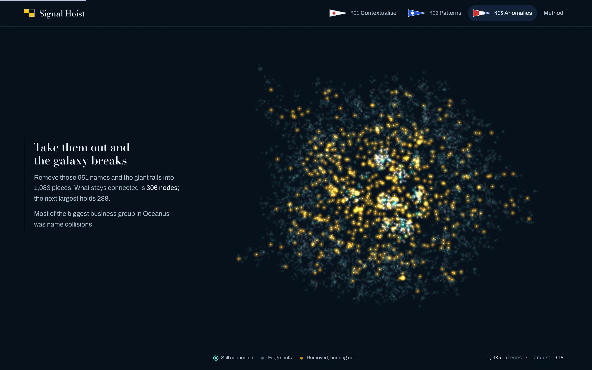
*Mid-morph: the galaxy breaking apart.*

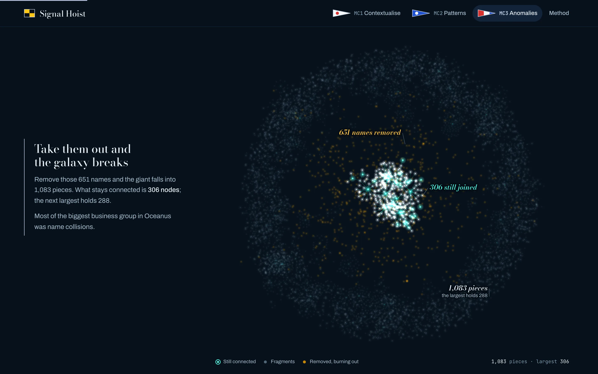
**3. Take them out and the galaxy breaks.** Remove those 651 names and the giant falls into 1,083 pieces. 306 nodes stay connected, and the next largest piece holds 288.

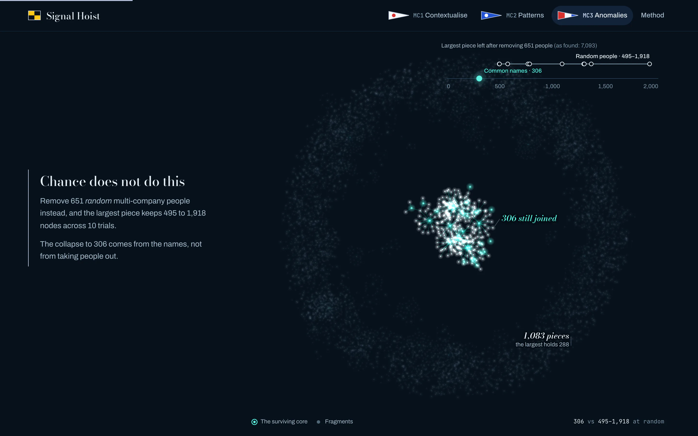
**4. Chance does not do this.** Remove 651 random multi-company people instead, and the largest piece keeps 495 to 1,918 nodes across 10 trials. The collapse comes from the names, not from taking people out.


**5. What stays anomalous is small.** BG00177: Angelica Wheeler owns Adriatic Squid and two sister firms, all fishing-named, across Marebak and Oceanus. BG00148: Anna Wheeler owns seven companies and Jason Carrillo is the contact for six; none declares a product.

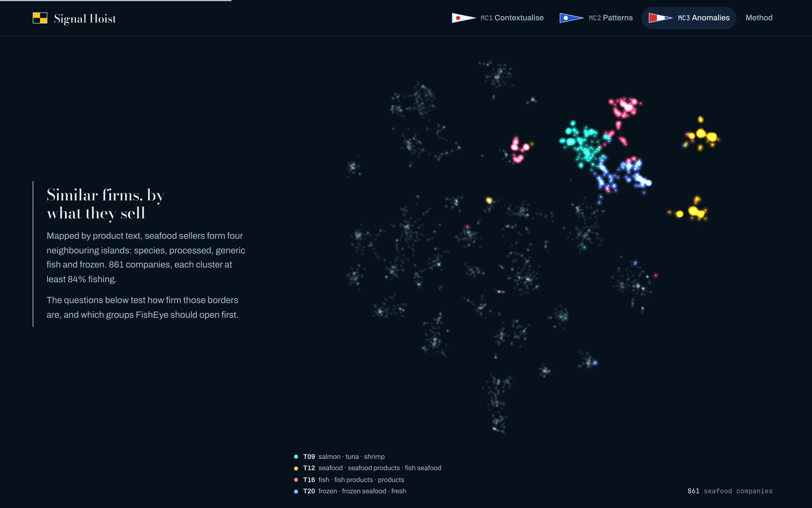
**6. Similar firms, by what they sell.** Mapped by product text, seafood sellers form four neighbouring islands (species, processed, generic fish and frozen): 861 companies, each cluster at least 84% fishing.

### Evidence views

The questions hold the surname-collision views, an anomaly scatter of 2,347 scored groups with explained detail, the component-size ablation, two t-SNE maps (text space and structure space), cluster terms, cohesion and stability with confidence pennants, a margin map, k-selection curves, the ranked investigation list with an evidence graph for each group, and an anomaly-versus-fishing overlap.

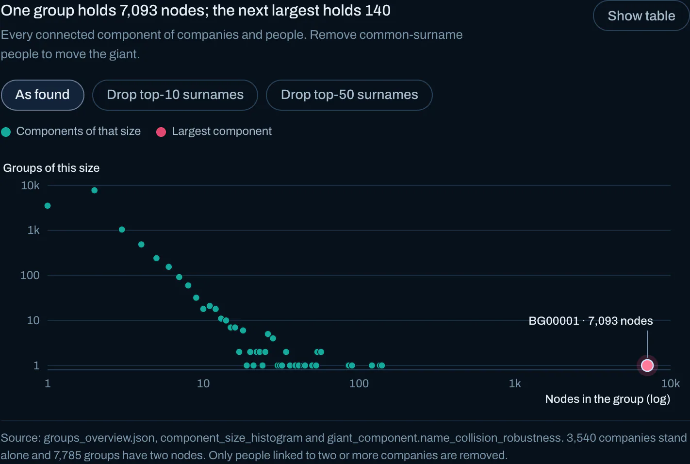


### Verdicts

| Group | Verdict | Confidence | Why |
|---|---|---|---|
| BG00177: Adriatic Squid and two sister firms | Suspect | Medium | Three fishing-named companies share one owner and one contact across Marebak and Oceanus. Adriatic Squid has conflicting "Footwear" and "Seafood" records. |
| BG00001.061: Fisher Marine conservation CJSC | Suspect | Medium | 16 companies: one with 26 owners, 62% unregistered, and an uncommon-name person tying four together. A Louvain slice, so its boundary depends on community detection. |
| BG00148: Anna Wheeler's seven companies | Possible | Medium | The most anomalous group of all. No product is declared, so the fishing link rests on names. |
| BG00069, BG00071 | Possible | Low | Multi-country clusters, but half the linking people have very common surnames |
| BG00861, BG00386 | Possible | Medium | Single firms registered in several countries |
| BG00003 | Insufficient evidence | High | 23 companies and 113 people, with no fishing link that can be verified |
| BG00016 | Unlikely | — | Fishing relevance 0.20 |

Across the 30 ranked groups there are 2 Suspect, 20 Possible, 7 Insufficient evidence and 1 Unlikely. The top 5% of anomalies are no more fishing-related than the rest (13% vs 17% reach relevance 0.5), so anomaly alone is not guilt.

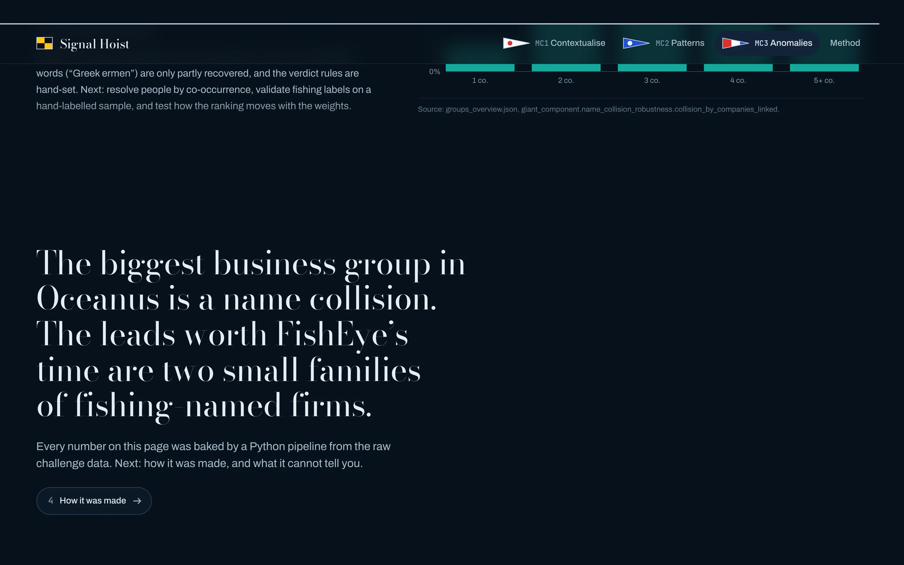

## Method

**What the page is for.** The Method page explains how the evidence was made: what each pipeline did to each graph, how verdicts are reached (rubrics written before they were applied, and null models), why signal flags are used, and how to reproduce every file.

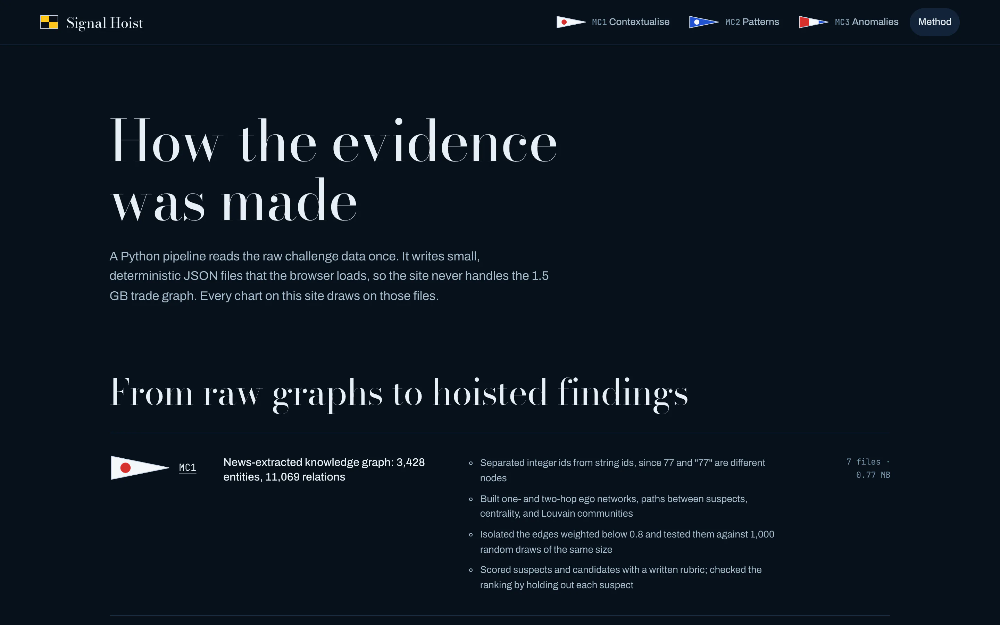

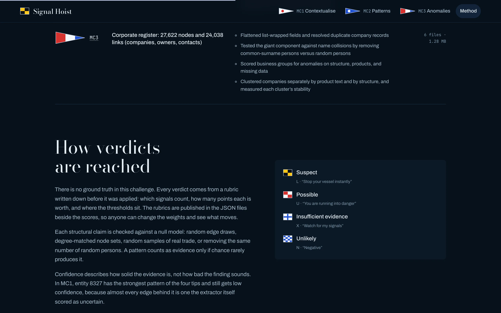

### On a phone

The stage pins above the story steps, and the steps scroll beneath it.

| Home | MC1 story step 2 | MC3 opener |
|---|---|---|
| 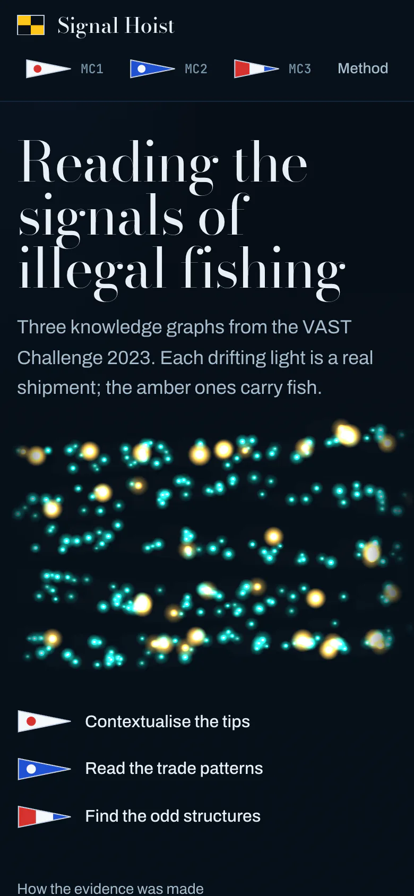 | 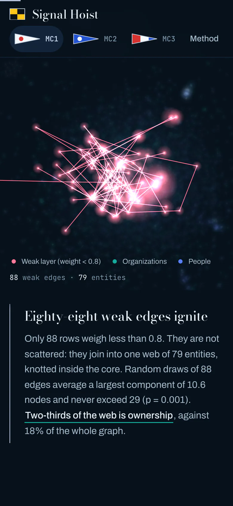 | 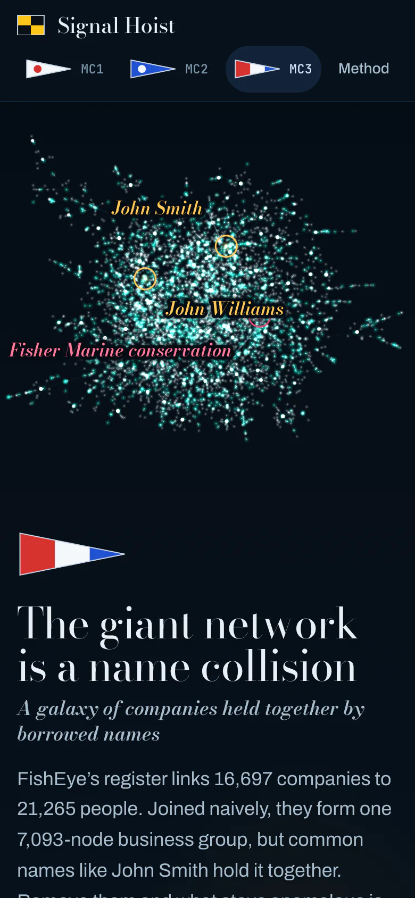 |

## Method summary

- **Pipeline.** A Python 3.12 pipeline (`pipeline/`) reads the raw challenge data once and bakes small JSON files into `app/public/data/`: 0.77 MB for MC1, 0.54 MB for MC2 and 1.28 MB for MC3. The 1.5 GB MC2 graph is streamed into Parquet first, so the browser never sees it. The answers and their numbers are in [`findings/`](findings/), and the JSON shapes in [`docs/data-contracts/`](docs/data-contracts/).
- **Determinism.** Node order is sorted, seeds are fixed and ties are broken by id, so a rebuild gives byte-identical files.
- **Null models.** Every structural claim is tested against chance:
  - MC1: 1,000 random 88-edge draws for the weak layer, degree-matched suspect sets for distances, and five Louvain seeds for communities.
  - MC2: 200 same-size samples of real 2034 trade for each bundle.
  - MC3: removing the same number of random people for the giant component, and bootstrap resampling for cluster stability.
- **Rubrics.** Verdicts come from written rubrics with published points and thresholds, such as MC1's seven signals (4+ points Suspect, 2.5–3.5 Possible). Confidence counts how much of the evidence rests on reliable edges or on structure alone.
- **Validation.**
  - MC1: leave-one-out ranking of the suspects, 300 random reweightings (mean Spearman 0.98) and feature ablation.
  - MC2: a k-means cross-check of the pattern rules (purity 0.57), and re-detection of successors on the augmented graphs.

## Repository structure

```
app/                  Vite + React + D3 site (static build, HashRouter, GitHub Pages)
  src/pages/          Home, MC1, MC2, MC3, Method, and per-chapter stories and charts
  src/styles/         Night-sea design tokens
  public/data/        Baked JSON consumed by the site (committed)
pipeline/             Python pipelines: mc1_build, mc2_to_parquet + mc2_build, mc3_build, stages, summary
findings/             Written answers to every question, with numbers and the JSON field behind each
docs/                 Plan, data contracts, and screenshots (docs/screenshots/)
submission/           VAST answer sheets (MC1–MC3), the combined report, images and PDF
scripts/              fetch_data.sh (raw data), capture_screenshots.mjs (screenshots)
```

## Run it

Requires **Node 24** and **Python 3.12**.

```bash
scripts/fetch_data.sh                               # downloads the challenge data into data/raw/ (not committed)
python3 -m venv .venv && .venv/bin/pip install -r pipeline/requirements.txt
cd app && npm ci
npm run data                                        # rebuilds every dataset from data/raw/
npm run dev                                         # Vite dev server
```

The baked JSON is committed, so `cd app && npm ci && npm run dev` alone is enough to explore the site.

**Screenshots.** With the dev server running (`npx vite --port 5174 --strictPort --host 127.0.0.1` in `app/`), this command refreshes `docs/screenshots/` and `submission/images/` (Playwright with Chrome; `cwebp` for compression):

```bash
node scripts/capture_screenshots.mjs [baseUrl] [--only=docs|submission]
```

**PDF.** `submission/build_pdf.sh` renders the report and the three answer sheets into `submission/VAST2023-Signal-Hoist.pdf`.

## Design

The visual world is a **night sea**: illegal fishing happens after dark, and the evidence is read the same way.

- **Colour.** The page is abyssal water (`#07111b`) with moonlight text. Light lives only in the data, as bioluminescent teal, amber, rose-red and blue marks drawn additively, and in the signal lamps that carry verdicts. Chrome never glows.
- **Type.** Bodoni Moda tells the story, Archivo runs the interface, and JetBrains Mono shows measurements.
- **Checks.** The categorical palette was validated for contrast and colour-vision deficiency on the dark ground. Pairs that sit close for colour-blind readers always carry a second encoding (shape, label or dash).
- **Tokens.** The design tokens are in [`app/src/styles/tokens.css`](app/src/styles/tokens.css), and the direction contract is at the top of [`app/index.html`](app/index.html).

The quality bar was the craft of the VAST Challenge 2022 entries, with an identity of its own. The design work used four skills: **impeccable**, **ui-ux-pro-max**, **emil-design-eng** and **dataviz**. They covered direction, critique and the finish review, UX and accessibility, motion and interaction polish, and chart form with colour validation.

[PRODUCT.md](PRODUCT.md) is the product brief. [DESIGN.md](DESIGN.md) records the night-sea visual system: tokens, type roles, the chapter structure, motion and the signal code.

## Limits and caveats

- **No ground truth.** Every verdict is a ranked lead with a stated confidence, not an accusation.
- **Assumed semantics.** MC1's edge `weight` and ownership direction are undocumented. Reading weight as extraction confidence is an assumption.
- **Judgement calls.** Rubric weights and thresholds are hand-set. They are published in the JSON so they can be challenged.
- **Thin evidence.** MC2 successor pairs rest on 3–5 shared partners, and stops late in 2034 cannot be told apart from missing data.
- **Names as identity.** MC3 identifies people by name only, so collisions inflate shared control. Fishing relevance mostly comes from names, because 77% of companies declare no product.
- **Fiction and provenance.** Oceanus, FishEye and every entity named here are fictional and come from the challenge data. This is an independent response written after the challenge, not an official submission. The official data is distributed through a request form, and `scripts/fetch_data.sh` pulls a public mirror of it.

## Submission

- [submission/REPORT.md](submission/REPORT.md): one combined, detailed report.
- [submission/MC1.md](submission/MC1.md), [MC2.md](submission/MC2.md), [MC3.md](submission/MC3.md): answer sheets in the official VAST format, within the word and image limits.
- [submission/VAST2023-Signal-Hoist.pdf](submission/VAST2023-Signal-Hoist.pdf): all of the above as one PDF.
