# VAST Challenge 2023: Mini-Challenge 1

**Entry Name:** Signal Hoist

**Team Member(s):**
[Name] — [Affiliation], GitHub @amukherjee1991

**Tools Used:**
Python (pandas, NetworkX, scikit-learn, SciPy, PyArrow), React, D3, Vite, Playwright

**Approximately how many hours were spent working on this submission in total?**
[AUTHOR TO FILL: hours]

**May we post your submission in the Visual Analytics Benchmark Repository after VAST Challenge 2023 is complete?**
[AUTHOR TO FILL: Yes / No]

**Video:**
Not provided

**Interactive version:** <https://amukherjee1991.github.io/Vast23/#/mc1> (every figure below is a screenshot of a view on this page; the views are interactive there)

---

## Questions

Figures are numbered *question.figure*: Figure 1.3 is the third figure in the answer to Question 1. Verdicts use one scale throughout: **Suspect**, **Possible**, **Insufficient evidence**, **Unlikely**, each with a confidence of **High**, **Medium** or **Low**.

The four entities named in FishEye's tip are Mar de la Vida OJSC, 979893388, Oceanfront Oasis Inc Carriers and 8327.

### Question 1

> Use visual analytics to dynamically display and explore context around the suspected entities listed above. What did you learn about each one? Can you connect them to illegal fishing? Provide evidence for or against the case that each entity is involved in illegal fishing and use visual analytics to express confidence in your conclusions. Limit your response to 600 words and 6 images.

The key context is a layer of weak links. 99.2% of the 11,069 edge rows have a weight between 0.80 and 0.99. The other 88 rows, weighted 0.03 to 0.77, form one connected component of 79 nodes (Figures 1.1, 1.2). This is not chance:

- **Size.** In 1,000 random draws of 88 edges, the largest component averaged 10.6 nodes and never exceeded 29 (p = 0.001).
- **Ownership.** 66% of the layer's edges are ownership, against 18% of all edges (p = 2e-23). It holds two circular-ownership loops.
- **FishEye.** "FishEye International" has 24 edges, 19 of them in this layer, so the layer may encode FishEye's own reporting.
- **Suspects.** Three of the four suspects are inside the layer (p = 5e-5); the fourth is one hop away.

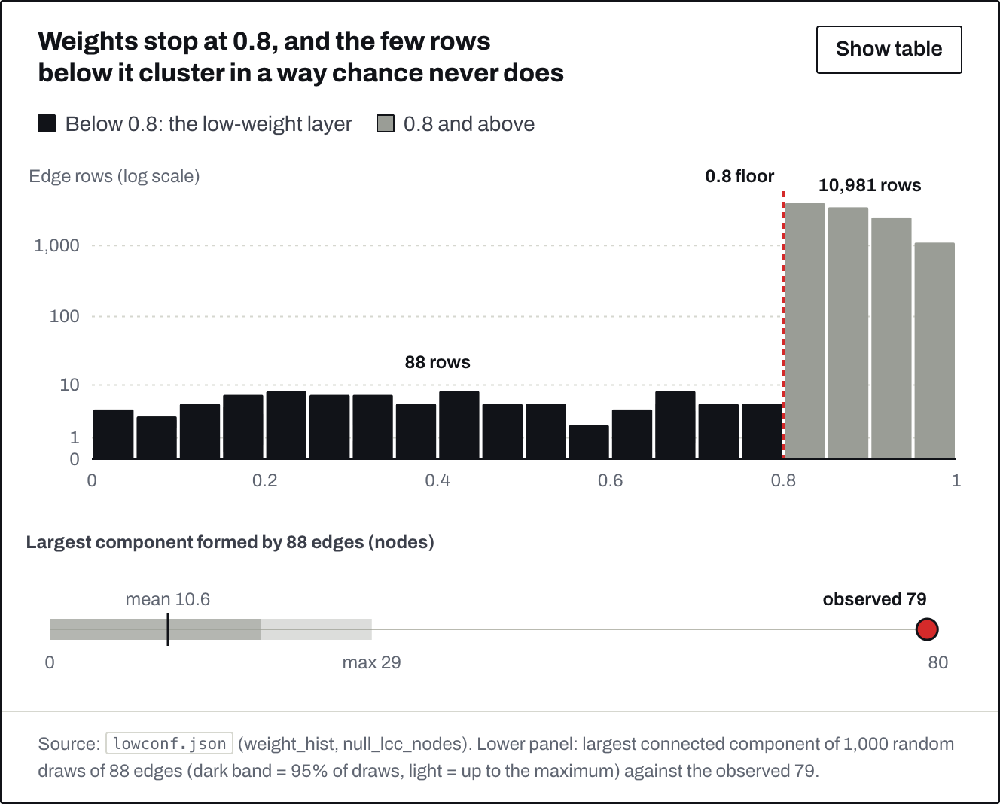
*Figure 1.1. Weights stop at 0.8; the few rows below cluster as chance never does.*

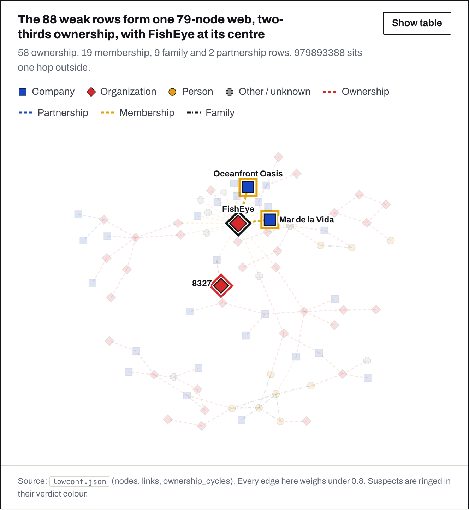
*Figure 1.2. The 88 weak rows: one 79-node web, two-thirds ownership, FishEye at its centre.*

Verdicts come from a published seven-signal rubric (4+ points Suspect, 2.5–3.5 Possible). Confidence counts full-point signals resting on edges weighted ≥ 0.8 or on structure alone (4+ High, 2–3 Medium, 0–1 Low). Ego views (Figures 1.3–1.6) ring each suspect in its verdict colour and dash weak edges.

**8327: Suspect, Low confidence (5.0 points; Figure 1.3).** A nameless organization with 13 neighbours. "Seabreeze Foods Ltd. Corporation United" owns it through one of the ten weakest edges in the graph (w = 0.12), and FishEye tags Seabreeze (w = 0.13). 8327 owns #40213337, which has six low-weight ownership rows and owns Sea Harvest, Sea Products and #58623386. 8327 has a membership edge (w = 0.82) to the garbled fragment "Illegal". A directed ownership chain runs from 8327 through #40213337, Sea Harvest, Amanda Mckenzie and Mar del Oeste Pic to 979893388, then to Oceanfront Oasis: six hops, weakest edge 0.32. Strongest structural signature of the four, but nearly every signal rests on edges below 0.8.

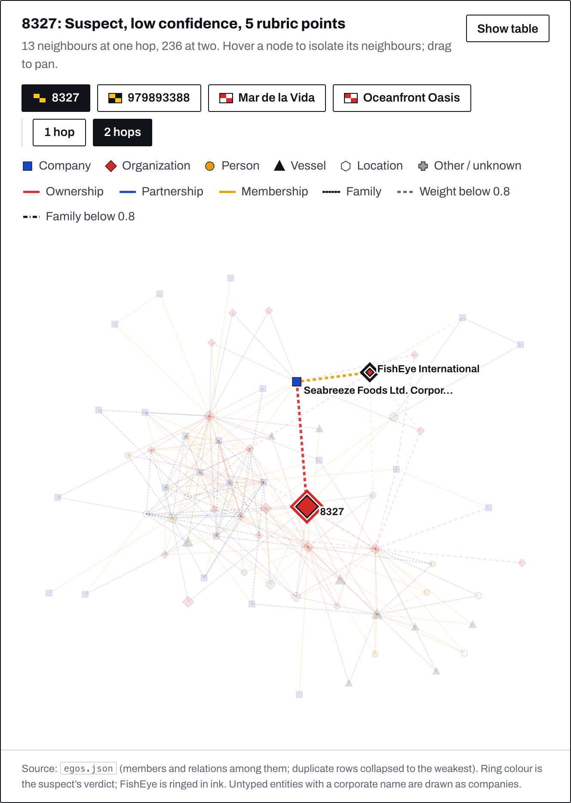
*Figure 1.3. 8327: owned by Seabreeze through a 0.12 edge; FishEye tags Seabreeze.*

**979893388: Suspect, Medium confidence (4.0 points; Figure 1.4).** A nameless hub: degree 177 and betweenness 0.096, both at the 99.8th percentile. It is one of 10 hubs forming a dense core (density 0.84). It owns 10 entities and is owned by 12; its upstream ownership tree reaches 307 entities within six hops. It owns Oceanfront Oasis through a high-weight edge (0.84), and its two-hop neighbourhood holds the fragments "ipoa-iuu" and "poached". It is not in the layer but sits next to two layer hubs. It reads as a holding layer, or an entity the extractor over-linked.

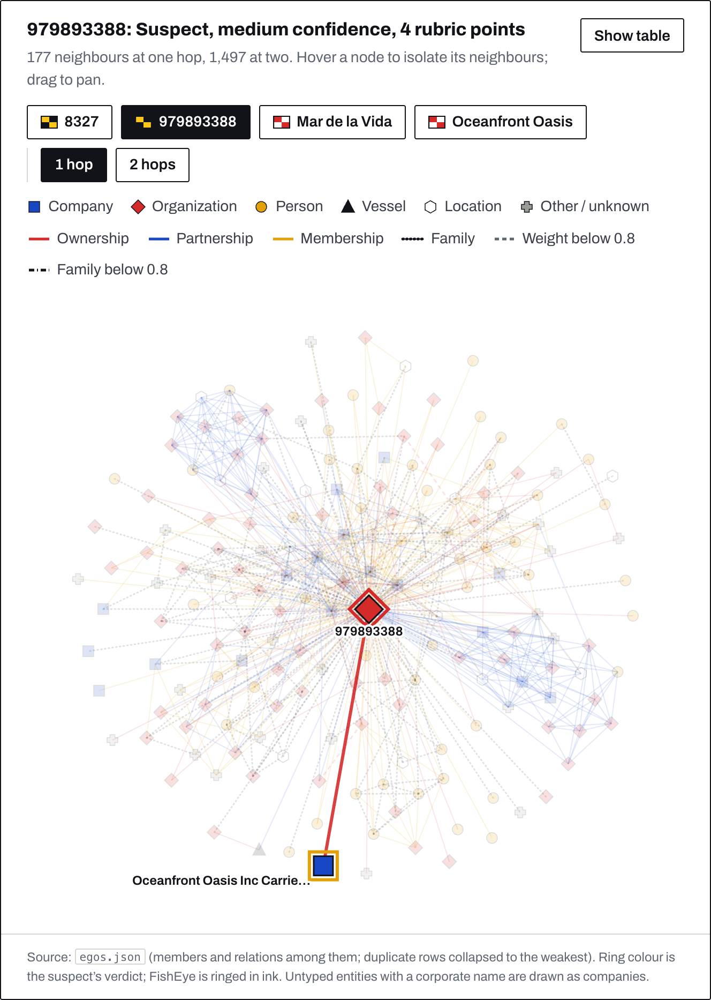
*Figure 1.4. 979893388, a hub, owns Oceanfront Oasis through a strong 0.84 edge.*

**Mar de la Vida OJSC: Possible, Low confidence (3.0 points; Figure 1.5).** Untyped, 15 neighbours, mostly memberships, 6 of them people. Its only low-weight edge is a FishEye membership (0.46). It owns one person, Jon White, and has no ownership chain. At two hops it reaches "Officer Pleads Guilty" and "Special Action Group Combat Organized Crime"; betweenness is at the 95th percentile. The weak FishEye tag is the main evidence.

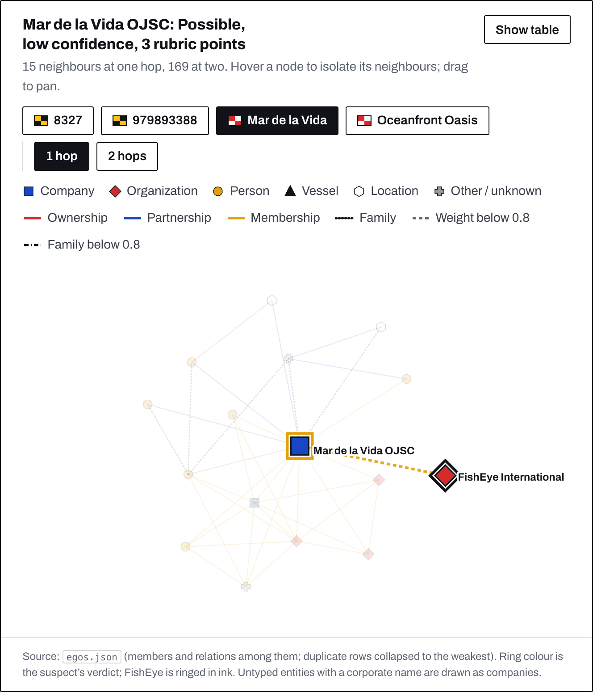
*Figure 1.5. Mar de la Vida touches the layer only through a weak FishEye membership.*

**Oceanfront Oasis Inc Carriers: Possible, Low confidence (3.0 points; Figure 1.6).** Four edges, all incoming: a FishEye membership (0.45), ownership by 979893388 (0.84), and two family edges from nameless organizations, probably noise. A thin subsidiary of a suspect.

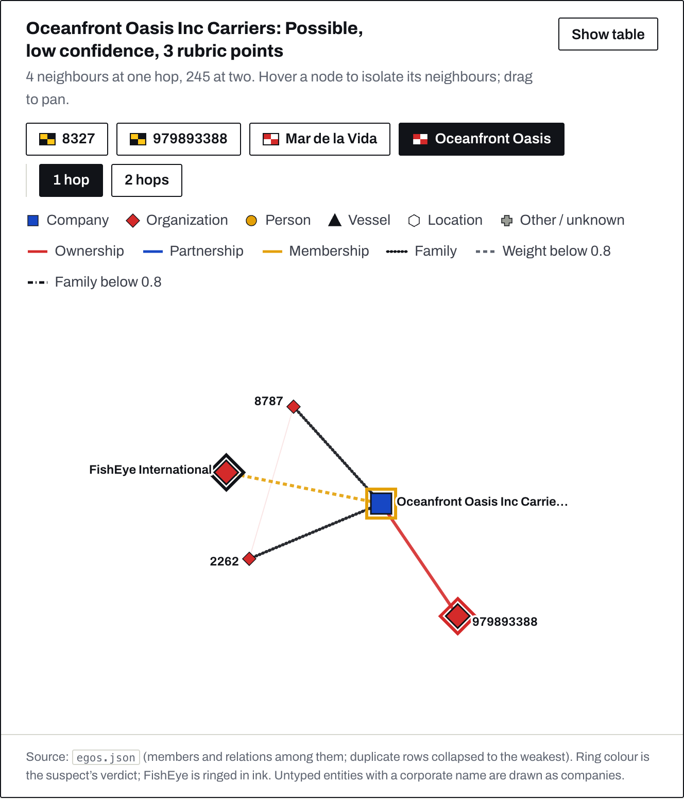
*Figure 1.6. Oceanfront Oasis: four incoming edges and nothing outgoing.*

**Caveats.** The data notes define neither `weight` nor ownership direction, so reading weight as extraction confidence is an assumption. 356 nodes (10%) are NLP debris.

### Question 2

> Use your visual analytics tool to compare and contrast what you learned about the suspect entities. Are there patterns that may indicate illegal activity? Use visual analytics to express confidence that a pattern exists and where uncertainty may be affecting this confidence. Limit your response to 400 words and 4 images.

The suspects fall into two pairs (Figure 2.1).

**Tagged small entities: Mar de la Vida and Oceanfront Oasis.** Named, untyped, with 15 and 4 neighbours. Each touches the layer only through one weak FishEye membership (0.46, 0.45), and FishEye is their only shared neighbour.

**Ownership intermediaries: 8327 and 979893388.** Nameless numeric organizations that both own and are owned (3 and 2; 10 and 12). Only they fire the rubric's shell marker. They differ in scale: 979893388 is at the 99.8th percentile of degree, 8327 at the 91st.

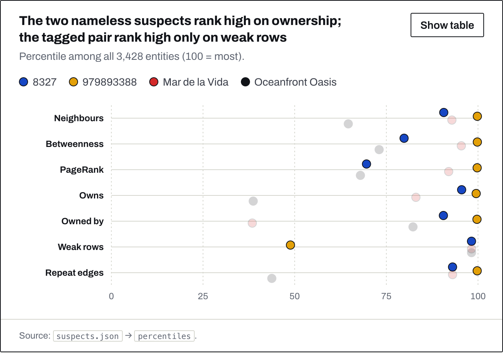
*Figure 2.1. The nameless pair rank high on ownership; the tagged pair rank high only on weak rows.*

**Patterns that point to illegal activity:**

1. **Ownership in the weak layer.** Two-thirds of its edges are ownership, with two circular loops (4 and 5 entities) and a five-hop directed chain.
2. **One chain through three suspects.** The six-hop chain links 8327, 979893388 and Oceanfront Oasis (Figure 2.3). Mar de la Vida has no ownership path to another suspect.
3. **FishEye tags.** Two suspects are tagged directly; 8327 through its owner, 979893388 through a neighbour.
4. **Nameless intermediaries.** 34 of the layer's 79 nodes are nameless numeric organizations.

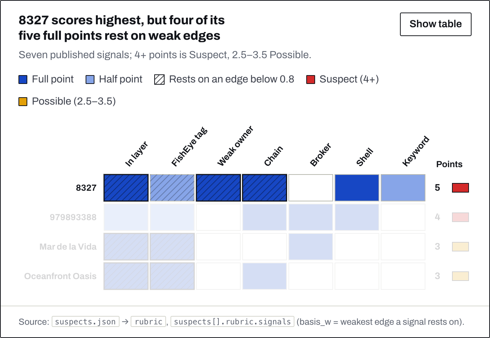
*Figure 2.2. 8327 scores highest, but four of its five full points rest on weak edges.*

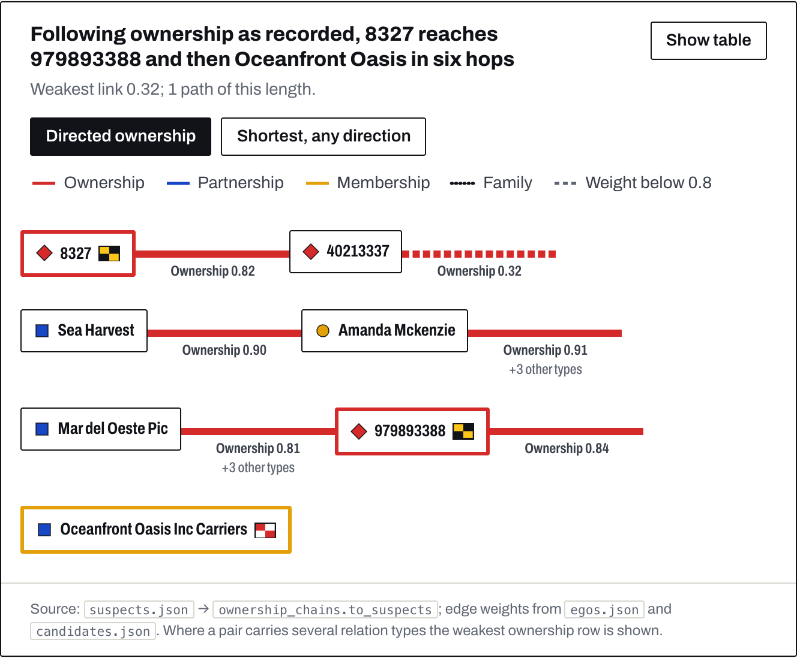
*Figure 2.3. Following ownership as recorded, 8327 reaches 979893388 and then Oceanfront Oasis in six hops.*

**Uncertainty, and how the views show it:**

- **Distances.** The suspects sit 2.17 hops apart on average, against 3.84 for random pairs, but 8% of random degree-matched sets are as close (Figure 2.4). Their closeness is mostly what their degrees predict. Pattern confidence: Low.
- **Communities.** Louvain places the suspects in three communities (modularity 0.69), and across five seeds only 0.33–0.63 of each suspect's community neighbours stay with it. No stable shared community.
- **Ownership direction.** Read literally, the chain has the company Sea Harvest owning the person Amanda Mckenzie. Direction cannot be trusted.
- **Edge weights.** The two Suspect verdicts differ in confidence: 979893388 rests on high-weight edges and structure (Medium), 8327 on edges from 0.12 to 0.32 (Low; Figure 2.2).

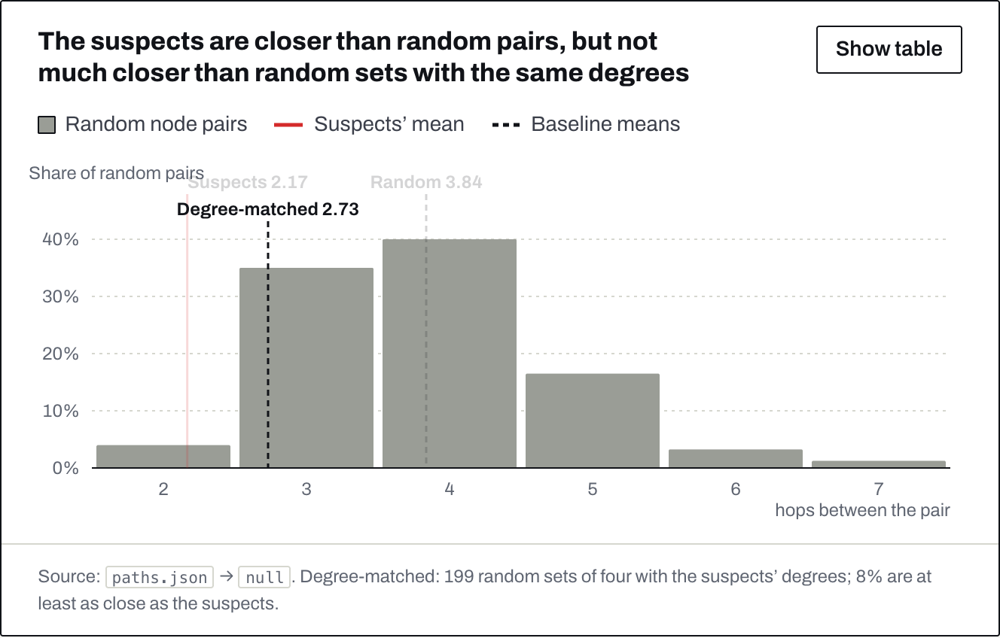
*Figure 2.4. Suspects are closer than random pairs, but not much closer than random sets with the same degrees.*

Overall confidence that a pattern exists: **Medium** for the weak ownership layer, **Low** for any tie between specific suspects.

### Question 3

> What other companies should FishEye investigate for illegal fishing? Show how your visual analytics can be used to find entities that are worthy of further investigation. Limit your response to 600 words and 6 images.

**How the tool surfaces them.** It scores all 1,209 companies and organizations on seven structural features, each converted to a percentile before weighting: low-weight edges (0.25), proximity to suspects (0.20), shared neighbours (0.15), ownership counterparties (0.15), relation-type profile similarity (0.10), repeated or mixed-type edges (0.10) and a FishEye tag (0.05). Each candidate comes with its feature contributions (Figure 3.1), an evidence subgraph of at most 22 nodes, and the verdict rubric used on the suspects (Figures 3.4, 3.5).

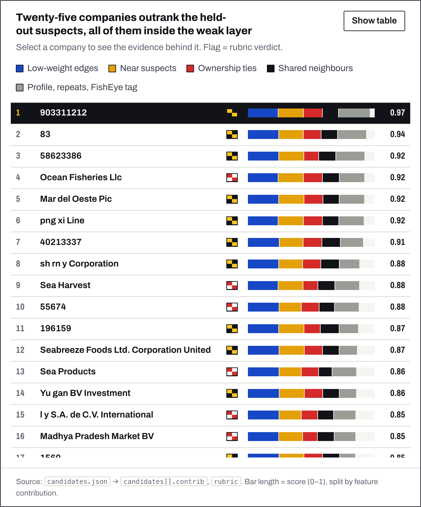
*Figure 3.1. The ranked candidate list; bar segments show each feature's contribution.*

**Validation.**

- **Held-out suspects.** Holding each suspect out and seeding with the other three, the held-out one ranks 11th, 51st, 41st and 35th of 1,210 (top 1–4%). Ranking by degree places them 96th, 7th, 528th and 128th (Figure 3.2).
- **Weight changes.** Across 300 random reweightings, the ranking keeps a mean Spearman correlation of 0.98 (minimum 0.89).
- **Ablation.** Without the low-weight feature only 8 of the top 25 stay (Figure 3.3). The list is mainly a way to rank the layer.

All 25 top candidates sit in the weak layer; 4 are hubs.

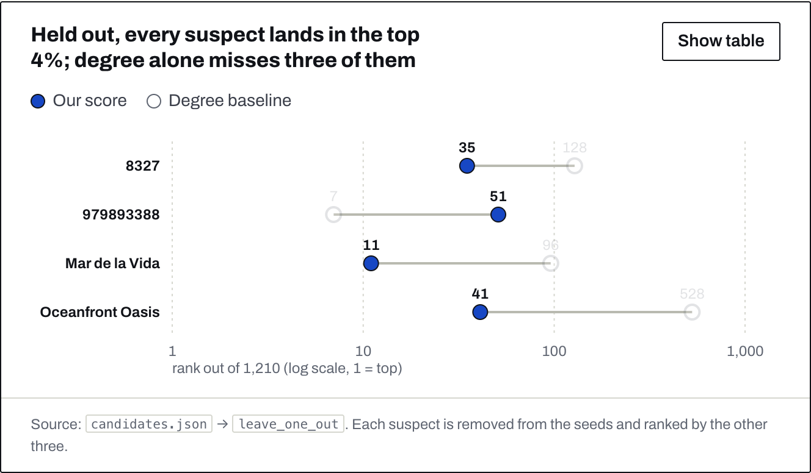
*Figure 3.2. Held out, every suspect lands in the top 4%; degree alone misses three of them.*

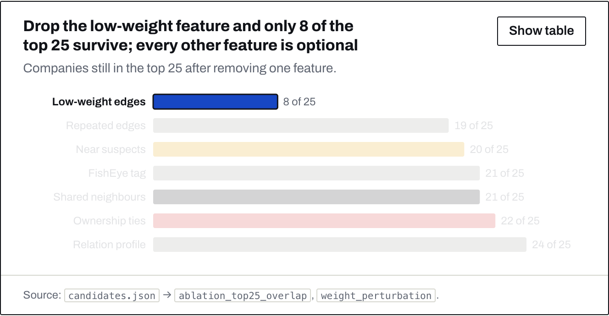
*Figure 3.3. Drop the low-weight feature and only 8 of the top 25 survive.*

**Investigate first: rubric Suspect with Medium or High confidence.**

- **#903311212** (rank 1, score 0.97; Figure 3.4). A hub with 234 neighbours, 43 owned and 42 owners. FishEye tags it, it has a low-weight ownership edge, it links to the "poached" fragment, and it reaches 979893388 through Mar del Oeste Pic.
- **#48** (rank 18, the only **High**-confidence result; Figure 3.5). FishEye tags it with a high-weight edge (0.95). It owns 5 and is owned by 4; an ownership chain reaches 979893388 through png xi Line and Ocean Fisheries Llc.
- **#40213337** (rank 7). The holding 8327 owns, with six low-weight ownership rows; it owns Sea Harvest, Sea Products and #196159.
- **#196159** (rank 11). Owned through #40213337 and next to a FishEye-tagged entity.
- **#83** (rank 2). FishEye-tagged; owns 4, owned by 1, with a chain to 979893388.
- **Mar del Oeste Pic** (rank 5), **png xi Line** (rank 6), **sh rn y Corporation** (rank 8). The first two are hub-core members that own or connect to 979893388; the third has six ownership ties and shares neighbours with the suspects.

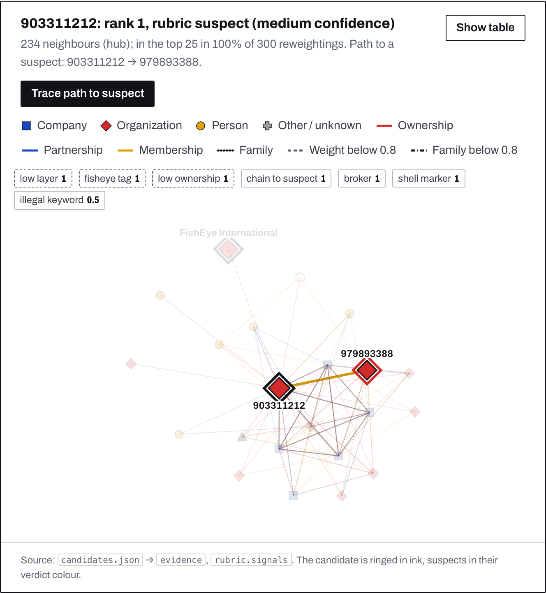
*Figure 3.4. Evidence subgraph for #903311212, rank 1, rubric Suspect (Medium).*

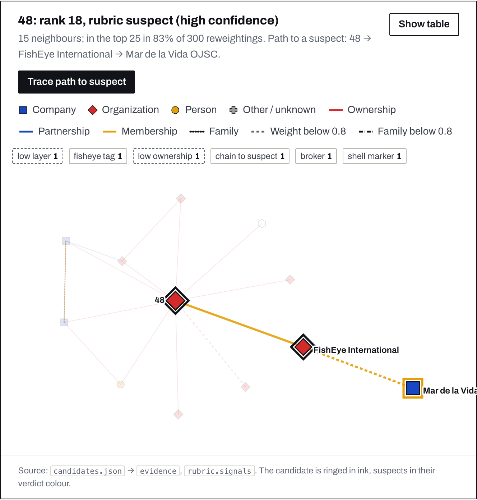
*Figure 3.5. Evidence for #48, the only High-confidence candidate, with its shortest path to a suspect traced.*

**Next tier: Suspect with Low confidence, or Possible.** Seabreeze Foods Ltd. Corporation United (8327's FishEye-tagged owner); Yu gan BV Investment; #1560, #8814 and #923825740; Ocean Fisheries Llc, Sea Harvest, Sea Products and #55674.

**Structures, not just entities.**

- Two circular-ownership loops: #21538 → #52193 → #958085 → #55674 → #21538, and American → #5421 → #81 → "l y S.A. de C.V. International" → #59 → American.
- A five-hop chain: Darin Torres → Federated → #1354 → Ht Shipping → Yu gan BV Investment → #4942.
- Nine people in the layer, including Daniel Henderson, Traci Shields and Joseph Smith. Weak family edges tie them together and several own layer companies, so they may be the beneficial owners.

**Confidence.** **Medium** for the layer as a whole, which is statistically clear. **Low to Medium** for each individual company, because the strongest edges in that evidence are also the least reliable ones.

### Question 4

> Reflection: What was the most difficult aspect of working with this knowledge graph? Did you have the tools and resources you needed to complete the challenge? What additional resources would have helped you? Limit your response to 300 words

The hardest part was deciding which parts of the graph to trust. The extraction errors are not random; they form structure that can look like evidence:

- About 10% of nodes are NLP debris (garbled text, words like "weeks" labelled as vessels), and 605 nodes have no type.
- Family edges join two non-people 46% of the time.
- 322 edge rows repeat the same source, target and type; 124 pairs carry several relation types at once.
- A 10-node hub core holds 3.4% of all edge rows; Ocean Fisheries Llc and SeaSpray Wave SRL Solutions share 40 edges of all four types.
- Integer and string ids collide (77 vs "77", 11 cases), so every id needs a type-aware key.
- The data notes declare 3,721 nodes and 7,422 edges; the file has 3,428 nodes and 11,069 rows, and one row misspells its weight field.

The most important signal, edge weight, is undocumented, and so is ownership direction. So the weak layer was treated as a hypothesis: tested against a random-edge baseline, checked for predicting held-out suspects better than degree, and every verdict records the weight of the edges it rests on. Hubs also hide structure, because many shortest paths run through them and community detection is unstable; the tool compares paths with and without hubs and runs Louvain with several seeds.

**Tools and resources.** Open-source Python and D3 were sufficient. What would have helped most is a data dictionary defining `weight` and the direction of ownership edges, and ground truth for even a few entities to calibrate the rubric.
