# VAST Challenge 2023: Mini-Challenge 2

**Entry Name:** Signal Hoist

**Team Member(s):**
[Name] — [Affiliation], GitHub @amukherjee1991

**Tools Used:**
Python (pandas, NetworkX, scikit-learn, SciPy, PyArrow), React, D3, Vite, Playwright

**Approximately how many hours were spent working on this submission in total?**
[AUTHOR TO FILL: hours]

**May we post your submission in the Visual Analytics Benchmark Repository after VAST Challenge 2023 is complete?**
[AUTHOR TO FILL: Yes / No]

**Video:**
Not provided

**Interactive version:** <https://amukherjee1991.github.io/Vast23/#/mc2> (every figure below is a screenshot of this page in its night-sea design: either a step of the scroll story that opens the chapter, or an evidence view from the question sections; all are interactive there)

---

## Questions

Figures are numbered *question.figure*: Figure 2.3 is the third figure in the answer to Question 2. Confidence is stated as **High**, **Medium** or **Low**.

**Data preparation.** The graph has 5,464,378 shipment edges; 155,291 (2.8%) exactly duplicate another and are dropped, leaving 5,309,087 across 34,576 companies, 245,807 shipper→receiver pairs and 84 months (2028-01 to 2034-12). HS codes for chapters 01–09 lost their leading zero (306170 is 0306.17, frozen shrimp), and the bundles store them with five digits (30729); appending a "0" matches the graph's codes 100% of the time. "Fish" means HS headings 0301–0309 plus 1604/1605: 13.9% of edges.

### Question 1

> Use visual analytics to identify temporal patterns for individual entities and between entities in the knowledge graph FishEye created from trade records. Categorize the types of business relationship patterns you find. Limit your response to 600 words and 6 images.

**The market as a whole (Figures 1.1, 1.2).** Yearly volume peaks in 2030 at 831k shipments and falls to 688k in 2034. Fish holds steady at about 96k–116k a year, so its share rises from 12.7% (2028) to 15.6% (2034). Fish is mildly seasonal: a calendar index of 0.84–0.89 in February–April and 1.05–1.08 in July–December, against 0.91–1.09 for all goods.

*Figure 1.1. Story step: each light is ~200 shipments on a current between countries; most flows end in Oceanus.*

*Figure 1.2. Story step: fish (amber) holds steady while total trade ebbs.*

**Individual companies (Figure 1.3).** The two roles behave very differently:

- **Shippers are durable.** Median span 59 months; 4,875 of 12,217 are active for 73–84 months.
- **Receivers are fleeting.** Median span 3 months; 44% appear in a single month.
- **Fish shippers churn more.** 2,139 of 4,299 fish-majority shippers are *transient* (they appear after the data starts and disappear before it ends), against 4,740 of 12,217 shippers overall.

The 150 per-company series online show flat hubs, step-ups, step-downs and bursts.

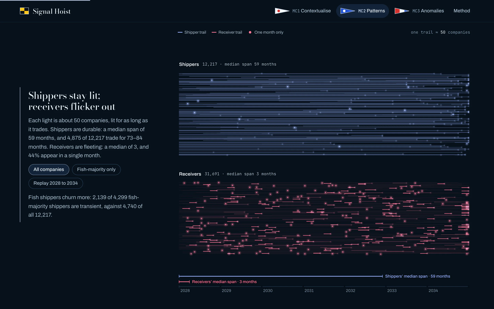
*Figure 1.3. Story step: shipper trails (above) last years; receivers (below) flicker out.*

**Relationships between companies (Figure 1.4).** Each pair's monthly series is classified by span, coverage, trend, seasonality and how strongly it ends; rules apply in order:

| Pattern | Pairs | Share of shipments | Signature |
|---|---|---|---|
| One-off | 108,067 (44%) | 2.6% | a single month |
| Intermittent | 60,968 | 14.5% | recurring but irregular |
| Short burst | 31,604 | 3.0% | ≤ 6 months, then nothing |
| Fading | 16,729 | 21.9% | second half ≤ ½ of the first |
| Ramping | 13,385 | 16.0% | second half ≥ 2× the first |
| Abrupt stop | 5,994 | 8.3% | regular trade that stops at full strength ≥ 12 months before the data ends |
| Steady | 4,634 (1.9%) | 32.6% | ≥ 24 months, ≥ 60% of months active |
| Seasonal | 4,426 | 1.2% | ≥ 75% of trade in the same 3 calendar months |

The network is a small core of steady pairs carrying a third of all shipments, ringed by a large fringe of one-off links. Only 737 pairs trade in both directions, so relationships run one way. Fish pairs follow almost the same mix; abrupt stops are slightly *rarer* among them (1.7% vs 2.4%), so an abrupt stop alone is not a sign of illegal fishing. As a cross-check, k-means (k = 8) on 101,115 recurring pairs agrees with the rules at a weighted purity of 0.57: steady, fading and ramping separate cleanly; the catch-all "intermittent" does not.

*Figure 1.4. Steady pairs are 1.9% of relationships but carry 32.6% of shipments.*

**Between entities: successors (Figure 1.5).** We took company pairs with very similar partner and product profiles (partner and HS cosine ≥ 0.7, ≥ 3 shared partners) and counted them by the gap between the earlier company's last month and the later one's first month:

- **Twins.** Most such pairs *coexisted* for 12–36 months (31 shipper pairs fall in −36..−6). These are sister firms, not replacements.
- **Restarts.** A second, narrower peak sits at gaps of 0–6 months: 1.7 pairs per gap-month, against 0.3 in the −6..0 window just before.

That excess is the signature of a company stopping and a look-alike starting straight afterwards: real but small, so successor pairs are rare and specific (see Question 4).

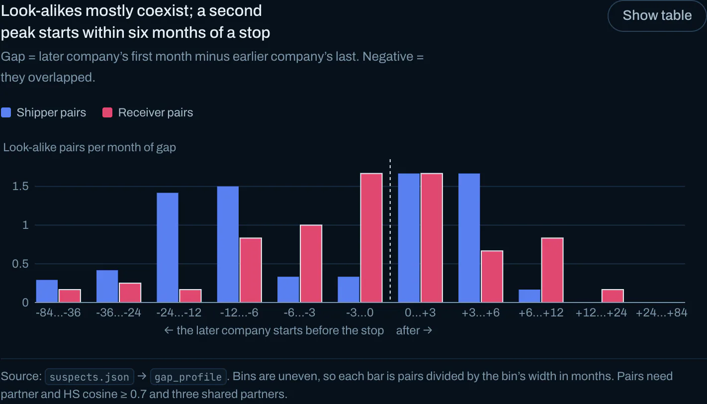
*Figure 1.5. Look-alikes mostly coexist; a second peak starts 0–6 months after a stop.*

**Confidence: High** for the aggregate patterns, which are counts over the full graph. The category boundaries are analyst choices, documented with each category in the tool.

### Question 2

> Evaluate the sets of predicted knowledge graph links FishEye has provided using visual analytics. Which sets are most reliable for completing the graph? Limit your response to 600 words and 6 images.

Each bundle is scored against the real graph on 11 components, each 0–1: repetition, novelty, schema, dates, month mix, pair and product history, HS mix, concentration, weight, value per kg, and node countries (Figures 2.1, 2.2). Distribution tests compare each bundle with **200 same-size random samples of real 2034 edges**, so small bundles are not punished for noise. Gates override the score:

- **Critical gates force "Unreliable":** under 25% of links distinct, fewer than 20 distinct links, or over 95% exact copies of graph edges.
- **Major gates cap the verdict at "Questionable":** under 50% of links carry a weight, or over 5% fall outside the graph's date window.

**Novelty is two-sided.** An exact match with a real edge (same shipper, receiver, HS code and day) is almost impossible by chance: some matches anchor a bundle to real records; all matches mean it adds nothing. The five diverse bundles independently converge on 42–59% matches.

*Figure 2.1. Story step: bundles as link grids; repeats dim, five stay bright.*

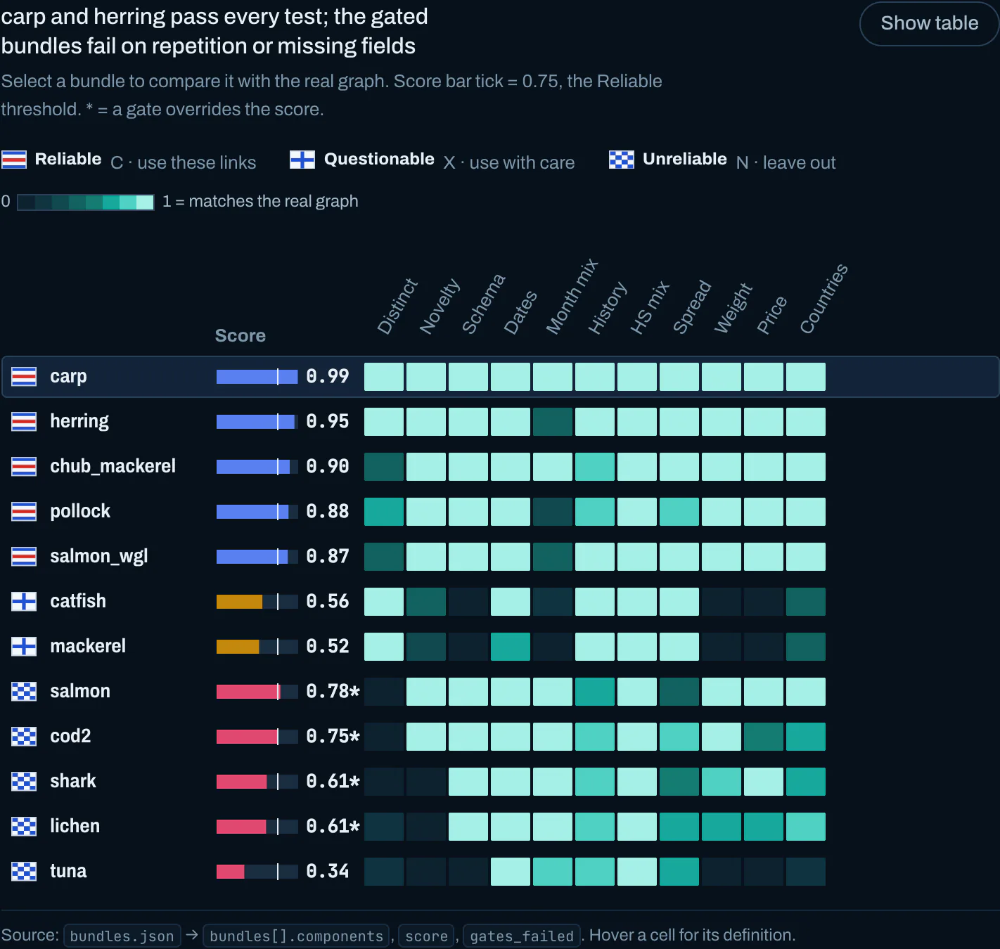
*Figure 2.2. Scorecard: 11 tests per bundle; flag = verdict, * = gate override.*

| Bundle | Score | Verdict | Decisive evidence |
|---|---|---|---|
| carp | 0.99 | **Reliable** | 165 distinct links, 44% anchored, value bias +0.09 dex, 95% country match (Figure 2.3) |
| herring | 0.95 | **Reliable** | clean; month mix slightly off (JSD 0.068 vs null p95 0.026) |
| chub_mackerel | 0.90 | **Reliable** | 52% of rows repeat, but 155 distinct links pass every realism test |
| pollock | 0.88 | **Reliable** | 34% repeats, somewhat concentrated (top target 17%) |
| salmon_wgl | 0.87 | **Reliable** | 57% repeats; 92 distinct links are realistic |
| catfish | 0.56 | **Questionable** | no weight at all, 8.7% of dates in 2035, 49% country match, 8% anchored |
| mackerel | 0.52 | **Questionable** | the same problems; 32% of dates in 2035 |
| salmon | 0.78* | **Unreliable** | 132 links are 13 records (9.8% distinct) |
| cod2 | 0.75* | **Unreliable** | 193 links are **4** records; top target "-53" never receives anything in the graph (Figure 2.5) |
| shark | 0.62 | **Unreliable** | 19 distinct records, all exact copies of graph edges |
| lichen | 0.61 | **Unreliable** | 23 distinct records, all copies; value bias +0.26 dex |
| tuna | 0.34 | **Unreliable** | no weights, 0% anchored, 18% distinct, 22% country match, 33% of links to one receiver (Figure 2.4) |

\*A gate overrides the score; on 4–13 distinct records the distribution tests have almost no power.

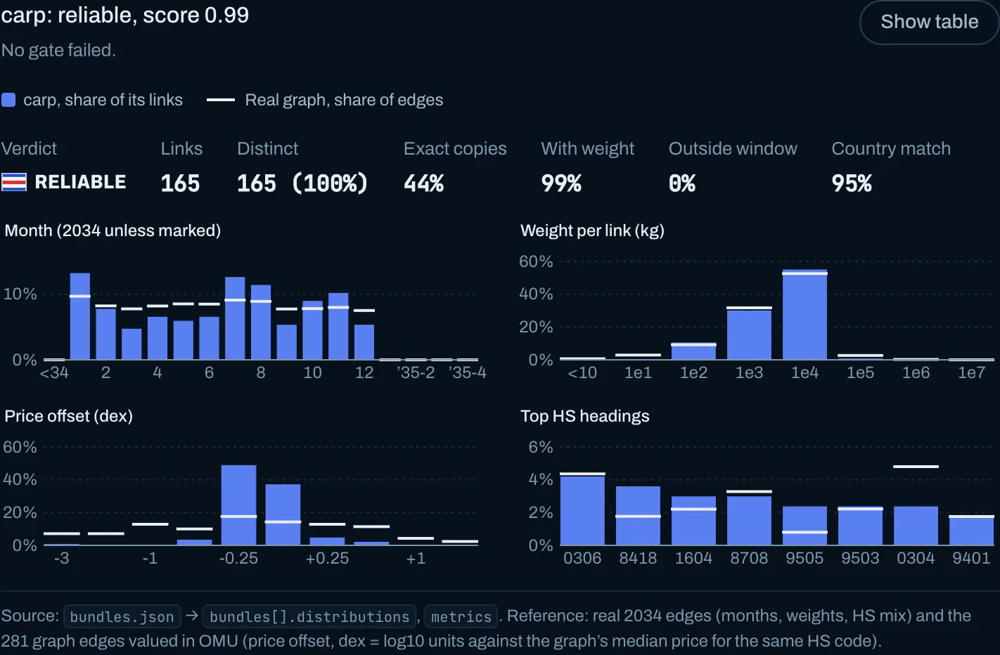
*Figure 2.3. carp (Reliable, 0.99) against real 2034 edges (white ticks): 165 distinct links, months, weights, prices and HS headings all in line.*

Three findings back the verdicts:

1. **Repetition separates the bundles most sharply.** Real data repeats 2.8% of records; the Unreliable bundles repeat 82–98%.
2. **Missing schema identifies the fabricated bundles.** catfish, mackerel and tuna have no weightkg (present on 100% of graph edges). They also disagree on node countries (22–49% vs 93–97%) and rarely match a real record.
3. **Prices.** Reliable bundles' OMU/kg sits within 0.12 dex of the graph's typical price per HS code; lichen and cod2 run high.

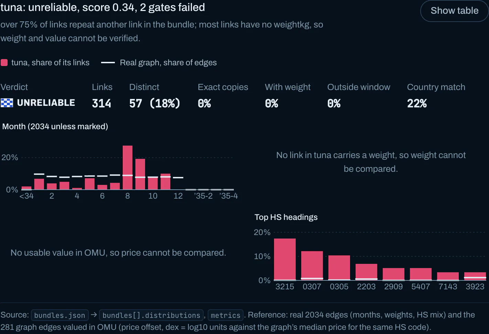
*Figure 2.4. tuna (Unreliable, 0.34): 314 links but 57 distinct, no weights or OMU values to compare, 22% country match.*

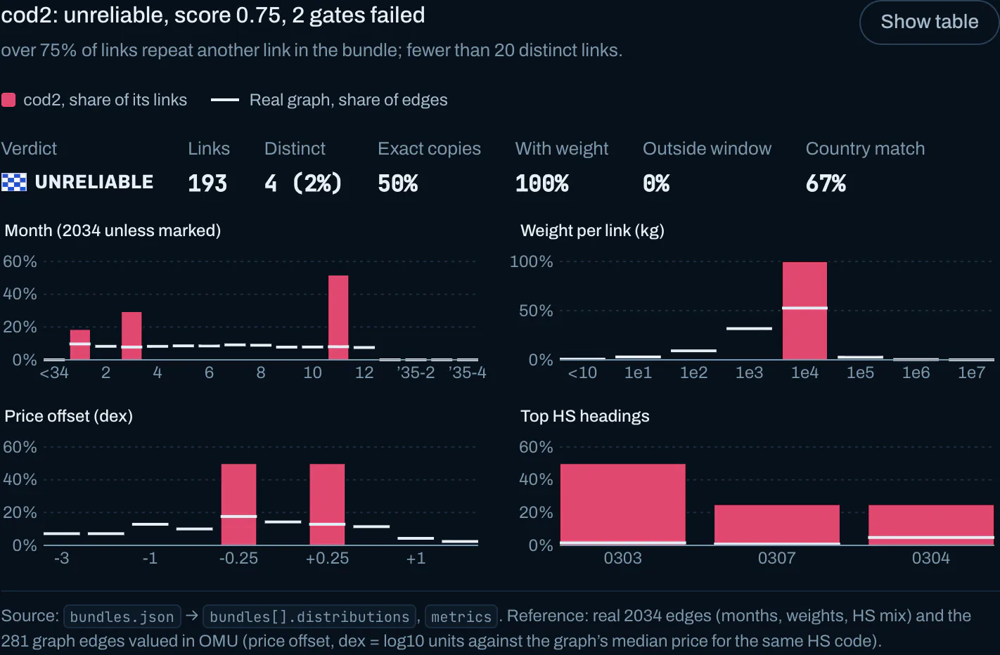
*Figure 2.5. cod2 (Unreliable, 0.75*): 193 links collapse to 4 distinct records, so every distribution is a few spikes.*

The bundles' pair sets barely overlap (Jaccard ≤ 0.05), so corroboration across bundles is impossible.

**Most reliable for completing the graph:** carp and herring, then chub_mackerel, pollock and salmon_wgl.

**Confidence: High** for the five Unreliable bundles and for carp and herring. **Medium** for chub_mackerel, pollock and salmon_wgl (realistic distinct links, unexplained repetition) and for catfish and mackerel (weight and value unverifiable).

### Question 3

> Illustrate how your visual analytics approach can be used to identify new patterns and/or anomalies that are present in the knowledge graph after you have added the links you deemed reliable in question 2. Limit your response to 300 words and 4 images.

- **The links add little (Figure 3.1).** The five Reliable bundles hold 1,015 links; only **347** are usable (distinct, new, inside the window): under 0.1% of 2034 volume. The 2034 fish share stays at 15.6%.
- **Pair patterns barely move (Figure 3.3).** 261 existing pairs gain links and 58 new pairs appear. Only 15 pairs change pattern, mostly one-off or short burst → intermittent, and fading or ramping → steady.
- **Three apparent stops are data gaps (Figure 3.2).** Predicted links keep three "stopped" companies trading: *Chhattisgarh Salt spray ОАО United* (receiver, 174 shipments; last real month 2034-03, predicted to 2034-11), *Bahía Azul Ltd Holdings* (shipper, 2034-05 → 2034-12) and *Okavango River S.A. de C.V. Solutions*. Late-2034 stops are partly missing data, so the successor detector requires 6 silent months and marks a pair Unlikely when predicted links revive the predecessor.
- **The flags are stable (Figure 3.4).** All 68 flagged successor pairs (8 Suspect, 60 Possible) keep their verdicts on the augmented graph, and also after adding the two Questionable bundles (701 links). That robustness is the most useful result.
- **Hubs get richer.** Added links go mostly to existing hubs: *hǎi dǎn Corporation Wharf* (33), *Sailors and Surfers Incorporated Enterprises* and *Mar del Este CJSC* (11 each). The predictions densify the core rather than reveal hidden companies.

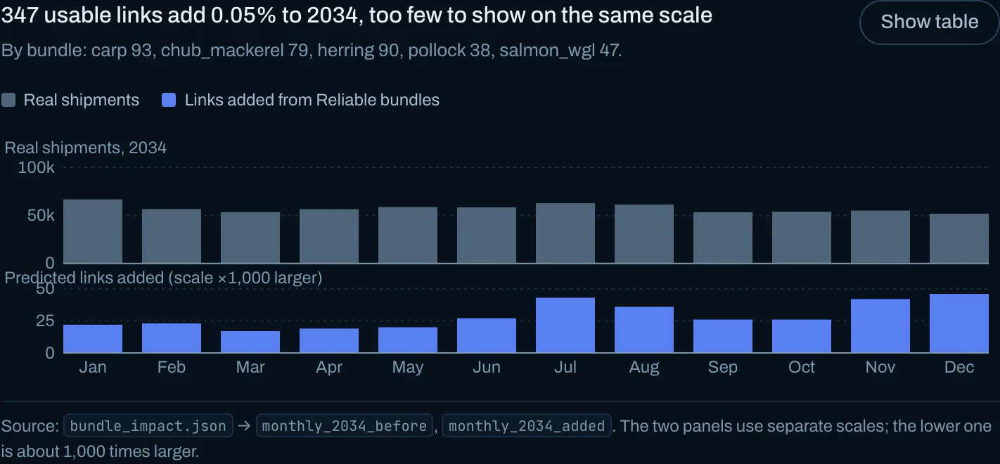
*Figure 3.1. 347 usable links (bottom, ×1,000 scale) add 0.05% to 2034.*

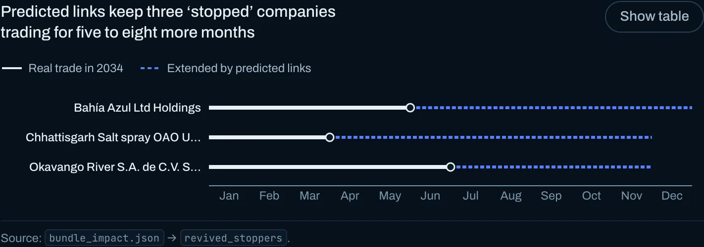
*Figure 3.2. Predicted links (dashed) keep three "stopped" companies trading.*

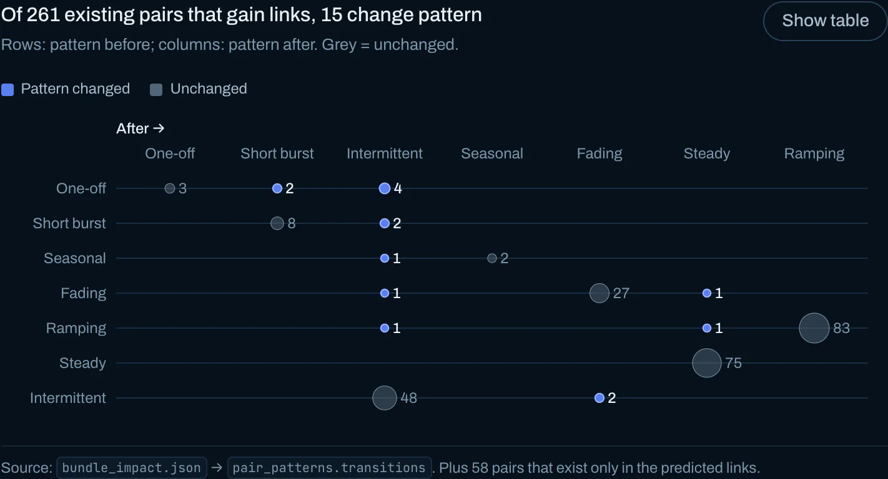
*Figure 3.3. Of 261 existing pairs gaining links, 15 change pattern.*

*Figure 3.4. Story step: the same 8 Suspect and 60 Possible lamps with and without added links.*

**Confidence: High** that the impact is small. **Medium** on the revivals: three cases, each from one bundle.

### Question 4

> Identify companies that fit a pattern of illegal fishing. Use visualizations to support your conclusions and your confidence in them. Limit your response to 300 words and 4 images.

We matched 2,780 shippers and 3,888 receivers that stop ≥ 6 months before the data ends with companies starting −6..+12 months from the stop. Similarity is TF-IDF cosine plus Jaccard on partners and HS codes, so shared hubs count little; shared partners must switch over. Of 872 candidate pairs: 8 Suspect, 60 Possible, 572 Insufficient evidence, 232 Unlikely (Figure 4.3).

**Suspect pairs** (all trade fish on both sides):

| Predecessor → successor | Confidence | Evidence |
|---|---|---|
| receiver **-811 → -206** | High | fillets (0304); 2032-12 → 2033-01; 5 shared shippers supply 78% of -206's trade (Figures 4.1, 4.2) |
| **Beachcomber's Bounty S.A. de C.V. Express → Karelians Limited Liability Company International** | Medium | Karelians also succeeds five more fish shippers that stopped in 2030 (Figure 4.4) |
| **Saltwater Surf Club Sp → Chhattisgarh GmbH & Co. KG Sea spray** | Medium | dried fish (0305); 2028-12 → 2029-02; all 3 shared partners switch |
| **Asveja Limited Liability Company → Marine Mavericks Marine biology** | Medium | molluscs (0307); 95% of successor's trade inherited |
| receiver **-812 → -556** | Medium | prepared crustaceans (1605); 5 shared shippers |
| receiver **-513 → -690** | Medium | identical partner set |
| **The Salty Dog Corporation → Gulf of Guinea Sp** | Low | 13-shipment predecessor |
| **Estrella del Sol CJSC → Mandalore S.A. de C.V. Logistics** | Low | 12-shipment predecessor |

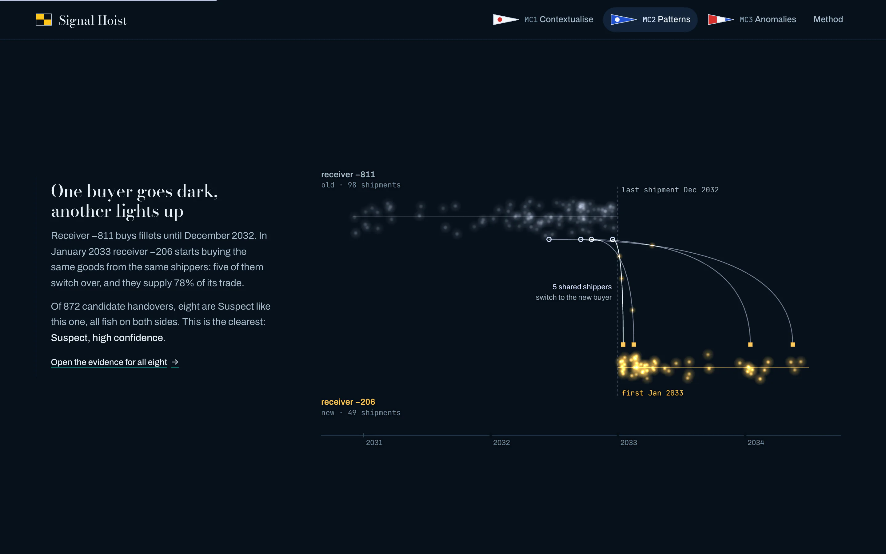
*Figure 4.1. Story step: −811 goes dark; five shippers arc to −206.*

*Figure 4.2. −811 → −206: mirrored monthly trade and each shared shipper's switch.*

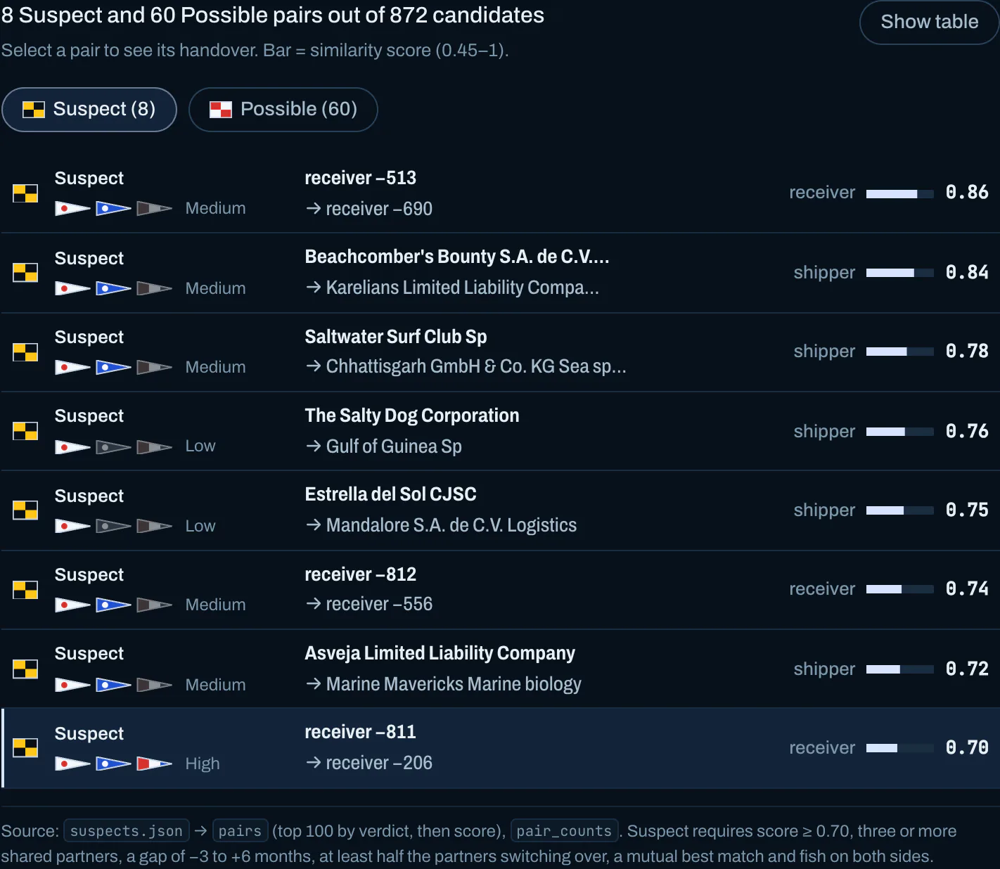
*Figure 4.3. 8 Suspect pairs of 872 candidates, with confidence pennants.*

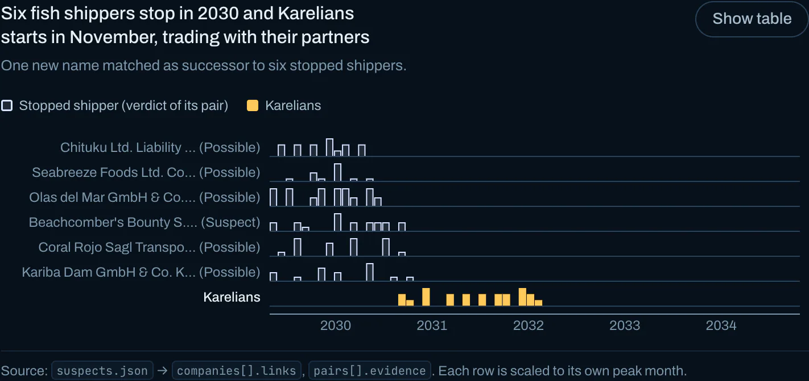
*Figure 4.4. Karelians starts after six fish shippers stop in 2030.*

**Confidence: Medium** overall: only 3–5 shared partners per pair, no ground truth, and 24 high-similarity pairs proved Unlikely because partners did not switch.

### Question 5

> Reflection: What was the most difficult aspect of working with this knowledge graph? Did you have the tools and resources you needed to complete the challenge? What additional resources would have helped you? Limit your response to 300 words

**The data needed the most care.**

- **HS codes:** the two code formats would have silently zeroed out chapter-03 fish links in every bundle.
- **Duplicates:** 2.8% of graph edges are exact duplicates.
- **Values:** the graph is in USD and the bundles in OMU, and only 281 graph edges carry OMU, so prices are compared as per-HS-code offsets against those 281 edges.
- **Names:** 22,004 company ids are bare negative numbers, so name similarity is useless as evidence.

**Null models changed the conclusions.** A first pass scored successors by raw cosine and rated catfish and mackerel "reliable". Weighting partners by rarity and comparing with same-size random samples of real 2034 edges reversed both. The gap profile showed most look-alikes coexist, so similarity alone would flood the list with false positives.

**Some evidence is ambiguous.** An exact copy of a real edge looked like a defect until five independent bundles each showed 42–59% exact matches; it is better read as evidence that a tool is anchored to real data.

**Limitations.** Scoring weights and thresholds are judgement calls, published so they can be challenged. Detection needs ≥ 2 shared partners, so very small companies cannot be judged. Stops near the end of 2034 cannot be told from missing data.

**Tools and resources.** Python with PyArrow (Parquet) made the 5.4M-edge graph tractable, and D3 covered the views. Documentation of the HS-code and currency conventions, and ground truth for a few known restarts, would have helped most. Next steps: compare against the MC1 and MC3 graphs, and let an analyst confirm or reject each pair with scores updating live.
