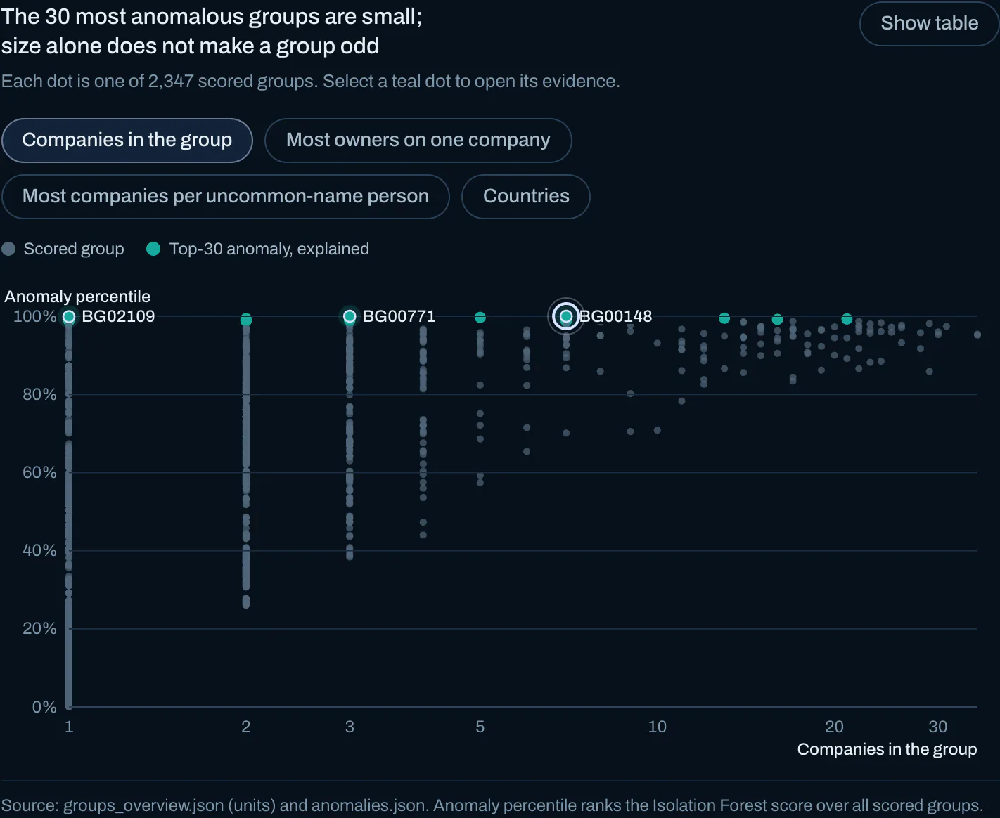
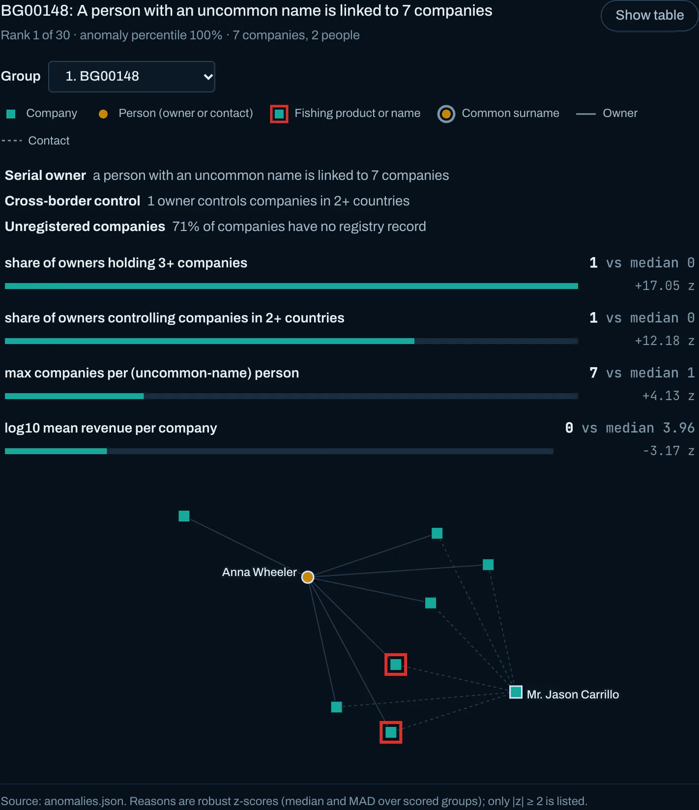
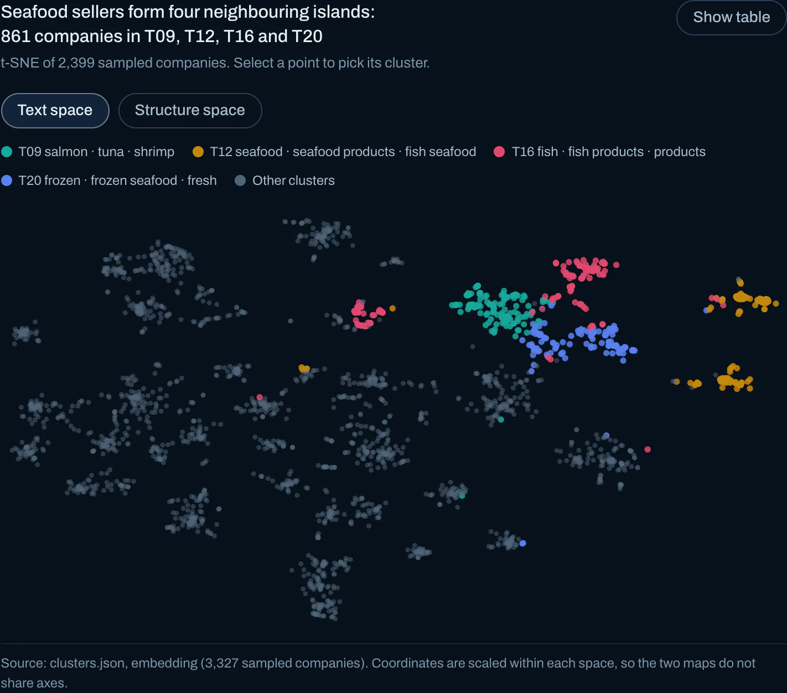
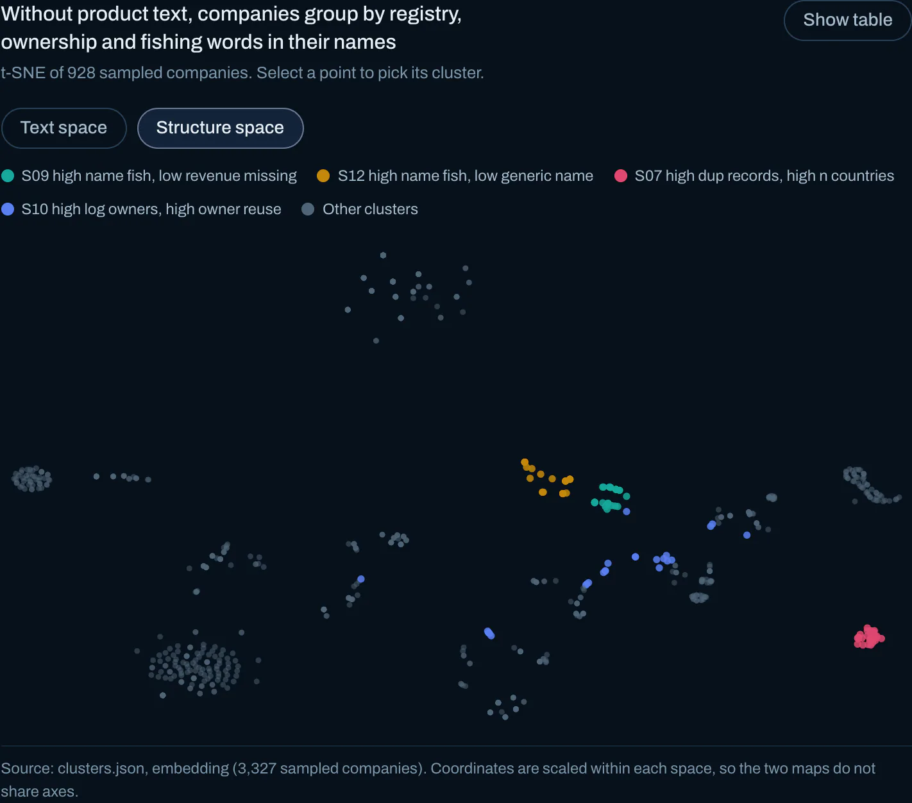
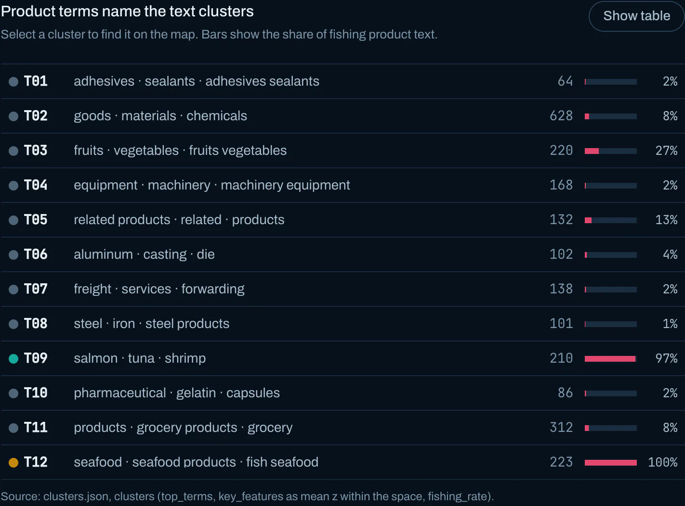
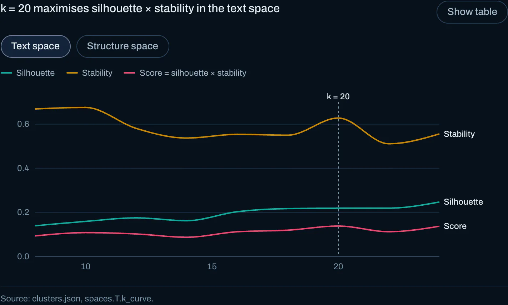

# VAST Challenge 2023: Mini-Challenge 3

**Entry Name:** Signal Hoist

**Team Member(s):**
[Name] — [Affiliation], GitHub @amukherjee1991

**Tools Used:**
Python (pandas, NetworkX, scikit-learn, SciPy, PyArrow), React, D3, Vite, Playwright

**Approximately how many hours were spent working on this submission in total?**
[AUTHOR TO FILL: hours]

**May we post your submission in the Visual Analytics Benchmark Repository after VAST Challenge 2023 is complete?**
[AUTHOR TO FILL: Yes / No]

**Video:**
Not provided

**Interactive version:** <https://amukherjee1991.github.io/Vast23/#/mc3> (every figure below is a screenshot of this page in its night-sea design: either a step of the scroll story that opens the chapter, or an evidence view from the question sections; all are interactive there)

---

## Questions

Figures are numbered *question.figure*: Figure 1.3 is the third figure in the answer to Question 1. Verdicts use **Suspect**, **Possible**, **Insufficient evidence** and **Unlikely**; confidence is **High**, **Medium** or **Low**.

**How the data is modelled.** Every link joins a company (source) to a person (target). We resolve the raw records into 16,697 companies, 21,265 persons and 24,931 distinct company–person edges, after splitting 807 links that list several source companies and merging 374 company names with duplicate records (145 of them in more than one country). 8,568 linked company names have no registry record. A *business group* is a connected component: 13,587 of them, with the one giant component split by seeded Louvain into 86 slices. The pipeline is deterministic (byte-identical output across runs).

### Question 1

> Use visual analytics to identify anomalies in the business groups present in the knowledge graph. Limit your response to 400 words and 5 images.

**1. Name collisions create the giant component (Figures 1.1, 1.2).** Persons are identified only by name. Of persons linked to one company, 21.9% have a top-50 surname; of those linked to 5+ companies, 92.6% do (Figure 1.3). The giant holds 7,093 nodes (1,506 companies). Removing the 651 multi-company persons with common surnames shrinks it to 306 nodes; removing as many random multi-company persons leaves 495–1,918 (10 trials). "John Smith", with 12 companies, is likely several people. Confidence: **High**.

*Figure 1.1. Story step: without the 651 common-surname people, the giant breaks into 1,083 pieces; 306 nodes stay joined.*

*Figure 1.2. Story step: random removals leave 495–1,918 nodes joined (strip, top right), never 306.*

*Figure 1.3. 13 of the 14 people with the most companies have a top-50 surname.*

**2. Ownership fragmentation.** Most companies have 0–2 beneficial owners, but 107 have 20+ and 38 have 30+. The largest are *Vespuci Sandbar Sp Brothers* (119), *Dutch Oyster Sagl Cruise ship* (90) and *Niger Bend AS Express* (71). 82 groups carry this flag. Confidence: **High**.

**3. Serial owners with uncommon names** (least likely to be collisions; Figures 1.4, 1.5). *Anna Wheeler* owns 7 companies and *Jason Carrillo* is the contact for 6 of them (BG00148). All 7 are unregistered or declare no product. BG00148 has the highest anomaly score of 2,347 scored groups. Confidence: **Medium**: two people sharing an uncommon name remain possible.

*Figure 1.4. The 30 most anomalous groups (teal) are small.*

*Figure 1.5. BG00148: Anna Wheeler owns 7 companies; Jason Carrillo is the contact.*

**4. Registry inconsistencies.** 112 groups contain a distinctive company name registered in several countries. 166 groups (274 companies) hold a fishing-named firm declaring an unrelated product, such as *Dutch Oyster … Cruise ship*, which sells textiles. *Adriatic Squid* has both "Footwear" and "Seafood" records. Confidence: **Medium**.

**5. Data-generation artefacts**, not IUU signals: 1,391 names contain a double space where a word was stripped ("Greek ermen"); 113 product texts end in "source: freelance researcher"; 11,420 Faker-style names ("Smith LLC") all sit in country "ZH".

**Method.** Each group with ≥ 3 nodes is scored by an Isolation Forest over 16 size-normalised features, explained by robust z-scores (median/MAD), plus 8 rule flags.

### Question 2

> Develop a visual analytics process to find similar businesses and group them. This analysis should focus on a business's most important features and present those features clearly to the user. Limit your response to 400 words and 5 images.

**Process.**

1. **Clean and resolve** records by name, as above.
2. **Classify product text** with keyword rules: *fishing* (1,043), *adjacent* (food, cold-chain or shipping; 623), *other* (2,209), *unknown* (12,822). Spot checks look right: "Exotic Coldwater Prawns" is fishing, "Freight forwarding" adjacent, "Gasket" other. Fishing words in company names are a second, independent signal on 1,201 names, including pinyin such as *yú* (fish) and *diao yu* (angling).
3. **Use two similarity spaces (Figure 2.1).** 77% of companies have no product text; in one shared space the binary "no text" columns dominate the clustering and inflate the silhouette. So:
    - **Text space** (3,875 companies): LSA of TF-IDF on 1–2 word terms (60 dimensions), weight 0.8, plus structural features, weight 0.2 (Figure 2.2).
    - **Structure space** (12,822 companies): structural features only (Figure 2.3).
4. **Choose k** by silhouette × bootstrap stability, because silhouette alone keeps rising with k on sparse text: k = 20 for text, k = 13 for structure (Figure 3.3).

*Figure 2.1. Story step: four seafood clusters lit on the text map, 861 companies.*

*Figure 2.2. Text space: seafood sellers form four neighbouring islands.*

*Figure 2.3. Structure space: firms without product text group by registry, ownership and name words.*

**Most important features, presented with each cluster's top terms and key features (Figure 2.4):**

- **Product terms** drive the text clusters. Four are seafood segments: species (T09: salmon/tuna/shrimp), processed seafood (T12), generic fish products (T16) and frozen seafood (T20). Together they hold 861 companies, each at least 84% fishing-labelled.
- **Ownership structure**: log owners, log contacts and *owner_reuse* (the most other companies held by any of a company's persons). It separates ownership-hub clusters such as S10 from single-contact shells such as S01.
- **Registry status and countries**: unregistered, number of countries and duplicate records give S07 (96 companies with duplicate records in several countries).
- **Fishing or maritime words in names** give S09 and S12, fishing-named firms with no product text; for unregistered companies this is the only fishing signal.
- **Revenue** presence and level separate S03 and S13, high-revenue firms with no product.

*Figure 2.4. Top terms name each text cluster; bars give its fishing share.*

Business groups are compared the same way: each group's 16 robust z-scores form a vector, and cosine similarity finds its nearest groups (listed beside each group in Figure 4.1).

### Question 3

> Measure similarity of businesses that you group in the previous question. Express confidence in your groupings visually. Limit your response to 400 words and 4 images.

Similarity inside a grouping is measured three independent ways:

1. **Cohesion:** mean pairwise cosine between members, and mean silhouette per cluster.
2. **Stability:** clusterwise Jaccard (Hennig). We refit k-means on ten 80% subsamples and record how well each cluster is recovered.
3. **Membership certainty per company:** margin = (d₂ − d₁) / d₂, where d₁ and d₂ are the distances to the nearest and second-nearest centroid; 0 means the company sits on a boundary.

**Confidence rule.** *High*: stability ≥ 0.85 and silhouette ≥ 0.25. *Medium*: stability ≥ 0.6 and silhouette ≥ 0.05. Otherwise *Low*.

- **Text space:** 2 High, 10 Medium, 8 Low (mean stability 0.60), so the text segmentation is only moderately reliable (Figure 3.1). Processed seafood (T12; silhouette 0.49, stability 0.83) is solid. Generic "fish products" (T16; stability 0.47) blurs into the other seafood clusters.
- **Structure space:** 8 High, 2 Medium, 3 Low (silhouette 0.63, mean stability 0.82). Tighter, but much of that comes from binary features: easy to cluster, not rich.

*Figure 3.1. Clusters sorted by stability, with bullet bars for stability and silhouette against the Medium and High ticks, and confidence pennants: only 2 of 20 text clusters reach High.*

**How confidence is shown visually.**

- A t-SNE map per space (3,327 sampled companies), coloured by cluster, with opacity encoding margin so boundary companies fade (Figure 3.2).
- The cluster table with bullet bars for stability and silhouette against the Medium and High thresholds, plus confidence pennants (Figure 3.1).
- A k-selection chart of silhouette, stability and their product, showing why k was chosen (Figure 3.3).
- For business groups, the investigation view shows a confidence badge with the reasons behind it (Figure 4.1).

*Figure 3.2. Opacity = margin: faded points sit near a cluster boundary, so their membership is uncertain.*

*Figure 3.3. Silhouette, stability and their product against k in the text space; k = 20 maximises the product.*

Confidence that the clusters are useful for segmentation: **Medium**. Confidence in fine-grained text clusters: **Low**.

### Question 4

> Based on your visualizations, provide evidence for or against the case that anomalous companies are involved in illegal fishing. Which business groups should FishEye investigate further? Limit your response to 600 words and 6 images.

**Short answer.** Structural anomaly and fishing activity overlap only moderately. Of the 119 most anomalous groups (top 5%), 13% have fishing relevance of 0.5 or more, against 17% of the rest (Figure 4.2): anomaly alone does not point to fishing. The data cannot prove IUU fishing; it can only rank where to look.

The ranking score is 0.45 × anomaly percentile + 0.30 × flag score + 0.25 × fishing relevance (Figure 4.1). Fishing relevance combines the fishing share of product text with fishing words in names; the product share is shrunk towards the corpus rate of 26.9% (a prior worth 2 companies), so "1 of 1 informative companies is fishing" does not count as 100%. We list 30 groups, with at most 15 Louvain slices of the giant component, each with a rule-based verdict: **2 Suspect, 20 Possible, 7 Insufficient evidence, 1 Unlikely**.

*Figure 4.1. Thirty groups ranked for FishEye (bars split by the three score terms), with BG00177 open: verdict, evidence graph, reasons and most similar groups.*

**Investigate first:**

1. **BG00177: Suspect, Medium confidence (Figures 4.1, 4.3).** A whole component of 3 fishing-named companies (*Adriatic Squid*, *Brisa del Este Cargo Bonito*, *Sea Harvest Marine*). One owner (*Angelica Wheeler*) and one contact (*Shelly Strong*) are shared across all three. *Adriatic Squid* is registered in both Marebak and Oceanus, with conflicting "Footwear" and "Seafood" records. Two of the three are unregistered. Anomaly in the top 0.2% of groups, fishing relevance 0.91, no name-collision exposure.
2. **BG00001.061: Suspect, Medium confidence.** A 16-company slice around *Fisher Marine conservation CJSC* and *Adriatic Tuna Seabass BV*. One company has 26 beneficial owners, a person with an uncommon name links 4 companies, and 62% of the companies are unregistered. As a Louvain slice, its boundary depends on community detection.
3. **BG00148: Possible, Medium confidence (Figures 1.5, 4.3).** The highest-anomaly group in the data. The *Anna Wheeler* / *Jason Carrillo* pair controls 7 companies across Oceanus and Coralmarica (*Baltic Sprat*, *jīn qiāng yú AG*, *Náutica del Mar*…). None declares a product, so the fishing link comes from names only.
4. **BG00069 and BG00071: Possible, Low confidence.** Small multi-jurisdiction clusters around *Yenisei Eel GmbH* (3 countries) and *Diao yu BV Logistics*. BG00069 would be Suspect, but half of the persons tying each group together have very common surnames.
5. **Single firms registered in several countries:** BG00861 *Diao yu bi sai SRL* and BG00386 *Delhi ers AS Holdings*, both Possible, Medium confidence.

*Figure 4.2. Every scored group by anomaly percentile and fishing relevance; the 30 ranked groups take their verdict colour. Top-5% anomalies are no more fishing-related than the rest.*

*Figure 4.3. Story step "What stays anomalous is small": BG00177 (Suspect; five people around three fishing-named firms) and BG00148 (Possible; Anna Wheeler and Jason Carrillo around seven companies).*

**Evidence against, or where we cannot conclude.** Several large groups have strong structure but no verifiable fishing link. BG00003 (23 companies, 113 persons, top company with 27 owners) is *Insufficient evidence* with **High** confidence. The ownership-hub slices (BG00001.001 around *Vespuci Sandbar*, 119 owners) sell wind-power equipment, textiles or beer: they look like shell or nominee structures, but not fishing ones. BG00016 is *Unlikely* (fishing relevance 0.20).

**Caveats.** 77% of companies have no product text, so most fishing relevance is inferred from names. Person identity is name-only, so collisions make shared control look larger than it is. Weights and thresholds are judgement calls, published with the tool so a reviewer can re-weight them.

**Confidence.** That the Suspect and Possible groups are a better-than-random IUU lead list: **Medium**. That any single group is engaged in IUU fishing: **Low**.

### Question 5

> Reflection: What was the most difficult aspect of working with this knowledge graph? Did you have the tools and resources you needed to complete the challenge? What additional resources would have helped you? Limit your response to 300 words

The hardest problem was identity, not anomaly detection. Persons are bare names, so a naïve connected-component analysis produces one 7,093-node "business group", mostly a product of common names such as "Michael Johnson". Testing surname removal against a random control turned that suspicion into a measurement. Every later signal (serial owners, cross-border control) then had to be restricted to uncommon names, and confidence drops wherever a group depends on collision-prone links.

The second lesson was about clustering mixed data. A single feature space reported a reassuring silhouette of 0.49, only because 77% of rows had an all-zero text vector. Splitting text from structure, and choosing k by silhouette × bootstrap stability, gave lower but more honest numbers.

Reproducibility needed explicit work. `Graph.subgraph(set)` iterates in hash order, so Louvain returned 85 or 87 communities depending on the run. Rebuilding every graph with sorted insertion and breaking ties by id made the outputs byte-identical.

**Limits.** The fishing classifier uses keywords, so it misses euphemisms. Names with stripped words ("Greek ermen") show the generator removed tokens; fragment rules only partly recover them. The verdict rules are transparent but hand-set.

**Tools and resources.** The open-source Python stack (NetworkX, scikit-learn) and D3 were sufficient. Unique person identifiers, or any attribute beyond a name, would have helped most, along with a hand-labelled sample of fishing companies. With more time we would resolve persons by co-occurrence (two "John Smith"s who share no company are probably different people), validate the fishing labels against that sample, and test how sensitive the investigation ranking is to its weights.
