# Signal Hoist: Reading the Signals of Illegal Fishing

**A visual-analytics report on the IEEE VAST Challenge 2023 (Mini-Challenges 1, 2 and 3)**

**Entry Name:** Signal Hoist  
**Team Member(s):** [Name] — [Affiliation], GitHub @amukherjee1991  
**Interactive version:** <https://amukherjee1991.github.io/Vast23/>  
**Source code:** <https://github.com/amukherjee1991/Vast23>  
**Answer sheets:** [MC1.md](MC1.md) · [MC2.md](MC2.md) · [MC3.md](MC3.md)

This is an independent portfolio response written after the challenge, not an official 2023 entry. Oceanus, FishEye International and every entity named here are fictional and come from the challenge data.

---

## Summary

FishEye International, an NGO that fights illegal, unreported and unregulated (IUU) fishing in the fictional island nation of Oceanus, hands analysts three knowledge graphs: entities and relations extracted from news text by NLP (MC1), seven years of customs shipment records with twelve bundles of AI-predicted links (MC2), and a corporate register of companies, owners and contacts (MC3). Each graph is noisy in a different way. Each one also contains a structure that looks like evidence but turns out to be an artefact of how the data was made.

The work produced three findings, each with a stated confidence:

1. **MC1.** 88 of the graph's 11,069 relations carry a weight below 0.8. They do not fall at random: they join into one 79-node web that random edges never produce (p = 0.001). Two-thirds of it is ownership, and three of the four tipped entities sit inside it. The web is a lead, not a verdict. The strongest structural suspect, **8327**, gets only *low* confidence, because almost every edge behind it is one the extractor itself scored as uncertain.
2. **MC2.** Only five of the twelve predicted-link bundles look like the real trade graph. Adding them changes no verdict. **Eight** pairs of fish traders fit the pattern of a company that stops trading and reappears under a new name, inheriting its partners. The clearest is receiver **−811 → −206** (Suspect, *high* confidence).
3. **MC3.** The register's 7,093-node "giant business group" is a name collision: remove the 651 multi-company people with common surnames and it falls to 306 nodes, which random removals never achieve. What stays anomalous is small: **BG00177** (three fishing-named firms sharing one owner and one contact across two countries) and **BG00001.061** are Suspect, with *medium* confidence.

Every number in this report comes from a deterministic Python pipeline over the raw challenge data. Every figure is a screenshot of the live, interactive site, where each claim sits beside the view that produced it.

---

## 1. Approach

### 1.1 Principles

Four rules shaped the work:

- **Claims stay next to their evidence.** Each finding on the site is a sentence placed beside the chart, network or table that supports it. Every chart has a table view and names its source file.
- **Every structural claim is tested against chance.** A pattern counts as evidence only if a null model rarely produces it. The null models are random edge draws, degree-matched node sets, same-size random samples of real trade, and removing the same number of random people.
- **Verdicts come from rubrics written before they were applied.** The rubrics say which signals count, how many points each is worth, and where the thresholds sit. They are published in the JSON next to the scores, so a reviewer can change a weight and see what moves.
- **Confidence measures how solid the evidence is, not how bad the finding sounds.** There is no ground truth in this challenge, so every verdict states which edges and which assumptions it rests on.

### 1.2 The verdict scale

All three challenges use one scale, drawn as flags from the International Code of Signals. Each flag's meaning at sea matches the finding:

| Flag | Verdict | Meaning at sea |
|---|---|---|
| **L** | Suspect | "Stop your vessel instantly" |
| **U** | Possible | "You are running into danger" |
| **X** | Insufficient evidence | "Watch for my signals" |
| **N** | Unlikely | "Negative" |

Numeral pennants show confidence: one hoisted means low, two medium, three high. Every flag pairs a pattern with a colour, so the code still reads in grayscale and for colour-blind readers.

### 1.3 The interactive site

The site is a static React and D3 application with one chapter per mini-challenge, plus a home page and a method page. The visual world is a **night sea**. The page is dark water (#07111b), and light lives only in the data: bioluminescent teal, amber, rose-red and blue marks, drawn additively. The signal lamps carry the verdicts. Bodoni Moda sets the story, Archivo the interface, and JetBrains Mono the measurements.

Each chapter opens with its headline claim and the strongest verdicts, hoisted as lamps. Next comes a **scroll story**: a full-bleed stage pinned to the screen while six short text steps scroll past and drive it. These are a constellation of the MC1 graph, currents of trade into Oceanus for MC2, and a "galaxy" of companies and people for MC3 that breaks apart. Below the story, the chapter answers each official question (Q1…Qn) with interactive evidence views. It ends with a closing bridge to the next chapter. The keys **n** and **p** step between chapters, and **0–4** jump to one.

*Figure 0.1. The home page. The mast on the right hoists the strongest finding from each challenge; the drifting lights below are real shipments, with fish in amber.*

---

## 2. Data and pipeline

A Python 3.12 pipeline (`pipeline/build_all.py`, run by `npm run data`) reads the raw data once. It writes small JSON files that the browser loads, so the site never handles the 1.5 GB trade graph: 7 files and 0.77 MB for MC1, 7 files and 0.54 MB for MC2, and 6 files and 1.28 MB for MC3.

| | MC1: news graph | MC2: trade graph | MC3: corporate register |
|---|---|---|---|
| Raw size | 3,428 nodes, 11,069 edge rows | 34,576 companies, 5,464,378 shipment edges, 12 bundles | 27,622 nodes, 24,038 links |
| Cleaning | Integer and string ids kept apart (`77` ≠ `"77"`, 11 collisions); 322 duplicate rows and 124 multi-type pairs recorded rather than dropped | 155,291 exact duplicates (2.8%) removed, leaving 5,309,087; HS codes repaired (lost leading zero, 5-digit codes in bundles) | 807 multi-source links split; 374 duplicate company names merged; list-wrapped fields flattened |
| Model | Weighted multigraph; ego networks, paths, centrality, Louvain | 245,807 shipper→receiver pairs × 84 months (2028-01 to 2034-12) | 16,697 companies, 21,265 persons, 24,931 company–person edges; 13,587 components |
| Key tests | 1,000 random 88-edge draws; degree-matched suspect sets; leave-one-out; 300 reweightings | 200 same-size samples of real 2034 trade per bundle; k-means cross-check | random-person removal; bootstrap cluster stability; Isolation Forest |

**Determinism.** Node order is sorted, seeds are fixed, and ties are broken by id, so two runs produce byte-identical files. The MC3 build is also stable across `PYTHONHASHSEED` values. That last property took work: `Graph.subgraph(set)` iterates in hash order, and Louvain returned 85 or 87 communities depending on the run until every graph was rebuilt with sorted insertion.

**Data notes worth knowing.** The MC1 data notes declare 3,721 nodes and 7,422 edges, but the file has 3,428 nodes and 11,069 edge rows, and one row misspells its weight field. The notes define neither `weight` nor the direction of ownership edges. In MC2, the graph's values are in USD and the bundles' in OMU, and only 281 graph edges carry OMU. In MC3, 77% of companies have no product text and people are identified by name alone.

---

## 3. MC1: a hidden layer of weak links

FishEye's tip names four entities: **Mar de la Vida OJSC**, **979893388**, **Oceanfront Oasis Inc Carriers** and **8327**.

### 3.1 The low-weight layer

99.2% of the 11,069 edge rows have a weight between 0.80 and 0.99. The other 88 rows, weighted 0.03 to 0.77, are not scattered:

- **Size.** They form one connected component of 79 nodes. In 1,000 random draws of 88 edges, the largest component averaged 10.6 nodes and never exceeded 29 (p = 0.001).
- **Ownership.** 66% of the layer's edges are ownership, against 18% of all edges (p = 2e-23). The layer holds two circular-ownership loops and a five-hop directed chain.
- **FishEye.** The "FishEye International" node has 24 edges, 19 of them in this layer. The layer may encode FishEye's own reporting.
- **Suspects.** Three of the four suspects are inside the layer (p = 5e-5), and the fourth is one hop away.

*Figure 3.1. MC1 story step "Eighty-eight weak edges ignite". The 88 weak rows, lit rose over the faint full graph, knot into one 79-node web.*

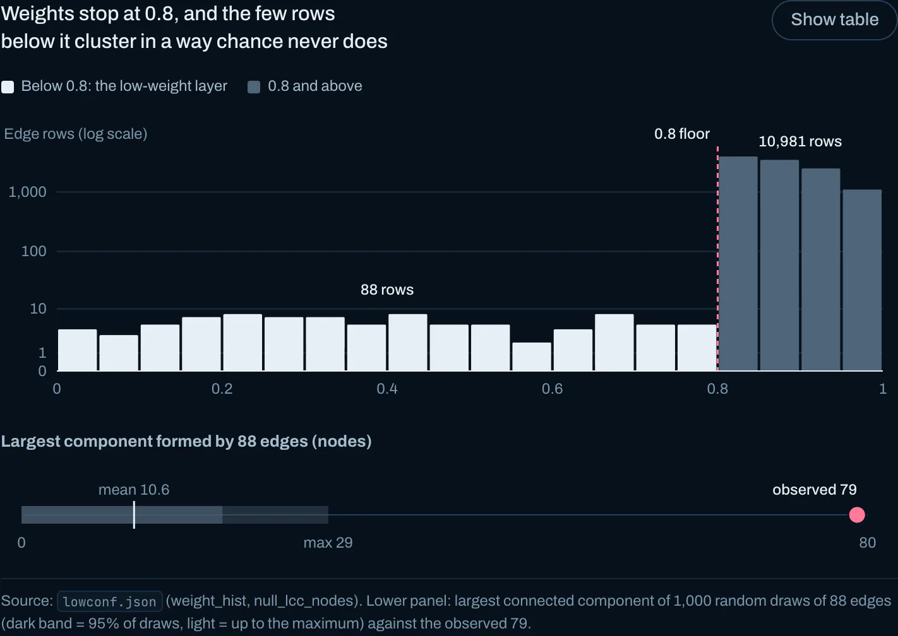
*Figure 3.2. Weights stop at 0.8. Below the floor, 88 rows form a 79-node component, against a mean of 10.6 and a maximum of 29 in 1,000 random draws.*

### 3.2 The four suspects

Verdicts come from a published seven-signal rubric: in the layer, FishEye tag, weak owner, ownership chain to another suspect, broker, shell marker, and keyword. A score of 4 or more points is Suspect, 2.5–3.5 Possible, 1–2 Insufficient evidence, and below 1 Unlikely. Confidence counts the full-point signals that rest on edges weighted ≥ 0.8 or on graph structure alone: 4 or more is High, 2–3 Medium, and 0–1 Low.

| Entity | Verdict | Confidence | Points | Why |
|---|---|---|---|---|
| 8327 | Suspect | Low | 5.0 | Owned by Seabreeze Foods through a 0.12 edge, and FishEye tags Seabreeze (0.13). Heads a six-hop ownership chain through #40213337, Sea Harvest, Amanda Mckenzie and Mar del Oeste Pic to 979893388 and Oceanfront Oasis (weakest link 0.32). Membership edge to the fragment "Illegal". Nearly every signal rests on weak edges. |
| 979893388 | Suspect | Medium | 4.0 | Nameless hub: degree 177 and betweenness 0.096, both at the 99.8th percentile. One of a 10-hub dense core. Owns 10 and is owned by 12; its upstream tree reaches 307 entities. Owns Oceanfront Oasis through a strong 0.84 edge. "ipoa-iuu" and "poached" lie two hops out. |
| Mar de la Vida OJSC | Possible | Low | 3.0 | Untyped; 15 neighbours, mostly people and memberships. Its only weak edge is a FishEye membership (0.46). No ownership chain. |
| Oceanfront Oasis Inc Carriers | Possible | Low | 3.0 | Four incoming edges: FishEye (0.45), its owner 979893388 (0.84), and two family edges from nameless organizations (probably noise). A thin subsidiary of a suspect. |

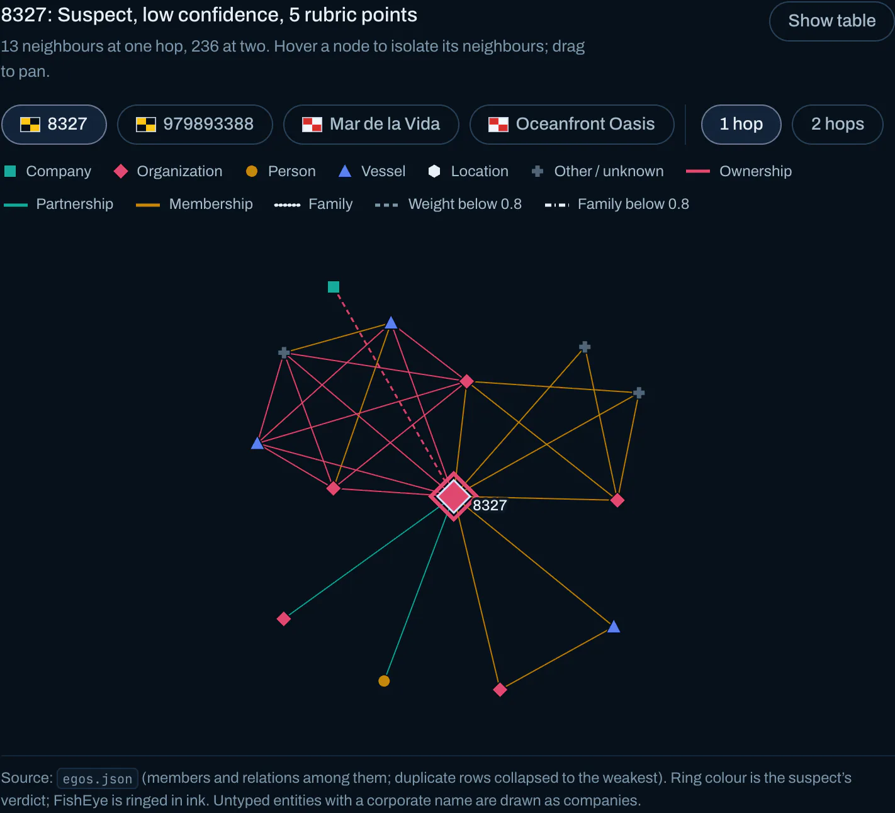
*Figure 3.3. 8327 at one hop. Dashed edges weigh below 0.8, and the ring is its verdict lamp.*

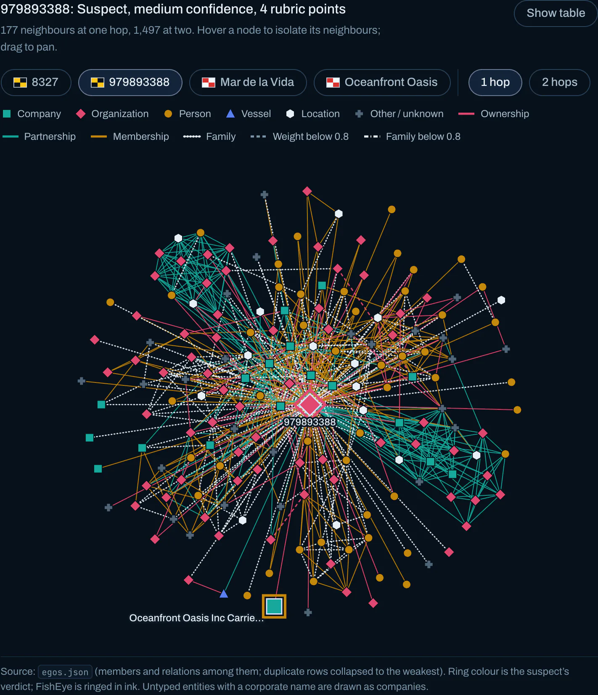
*Figure 3.4. 979893388, a 177-neighbour hub. Its strong edge to Oceanfront Oasis is at the bottom.*

**Two pairs, not four suspects.** The suspects split into two pairs. Mar de la Vida and Oceanfront Oasis are small named entities, each tied to the layer by one weak FishEye membership. 8327 and 979893388 are nameless ownership intermediaries that both own and are owned, and only they fire the rubric's shell marker.

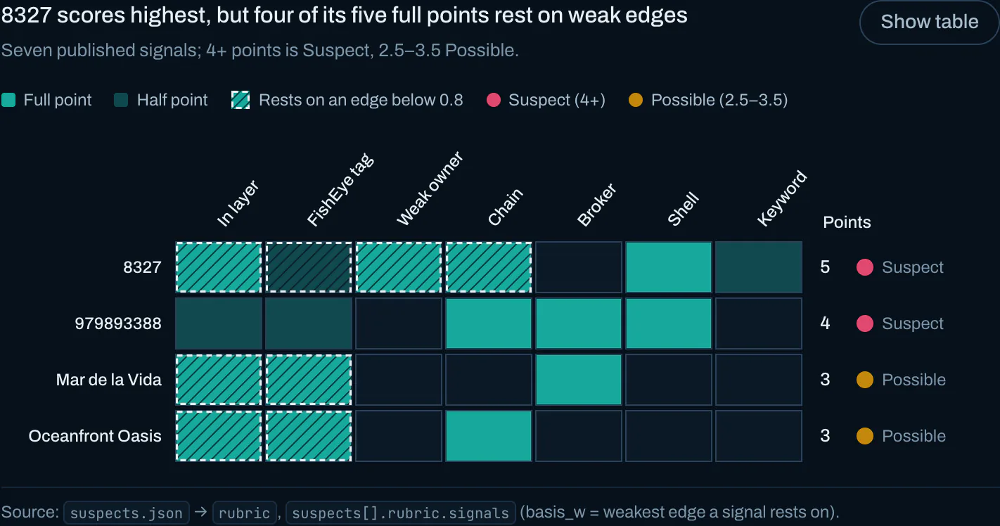
*Figure 3.5. 8327 scores highest, but four of its five full points rest on edges below 0.8 (hatched).*

*Figure 3.6. Following ownership as recorded, 8327 reaches 979893388 and then Oceanfront Oasis in six hops.*

**What is uncertain.**

- **Distance.** The suspects sit 2.17 hops apart on average, against 3.84 for random pairs. But 8% of random four-node sets with the same degrees are as close, so their closeness is mostly what their degrees predict.
- **Communities.** Louvain puts them in three communities (modularity 0.69), and across five seeds only 0.33–0.63 of each suspect's community neighbours stay with it.
- **Ownership direction.** Read literally, the chain has the company Sea Harvest owning the person Amanda Mckenzie, so the direction cannot be trusted.

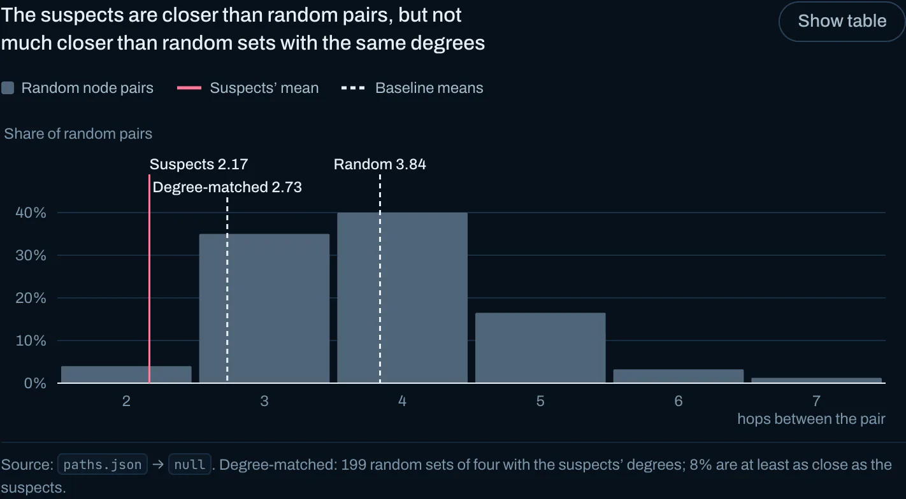
*Figure 3.7. The suspects are closer than random pairs, but not much closer than random sets with the same degrees.*

### 3.3 Who else FishEye should investigate

All 1,209 companies and organizations are scored on seven structural features, each converted to a percentile before weighting:

| Feature | Weight |
|---|---|
| Low-weight edges | 0.25 |
| Proximity to suspects | 0.20 |
| Shared neighbours | 0.15 |
| Ownership counterparties | 0.15 |
| Relation-type profile similarity | 0.10 |
| Repeated or mixed-type edges | 0.10 |
| FishEye tag | 0.05 |

**Validation.**

- **Leave-one-out.** Held out of the seeds, each suspect ranks 11th, 51st, 41st and 35th of 1,210 (top 1–4%). Degree alone places them 96th, 7th, 528th and 128th.
- **Weight perturbation.** Across 300 random reweightings, the mean Spearman correlation is 0.98 (minimum 0.89).
- **Ablation.** Dropping the low-weight feature keeps only 8 of the top 25, so the list is mainly a way to rank the layer. All 25 top candidates sit in the layer.

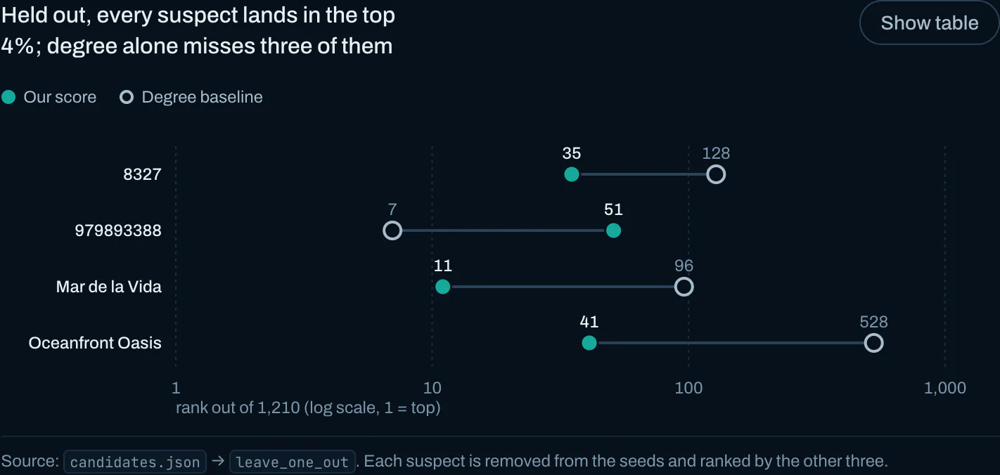
*Figure 3.8. Held out, every suspect lands in the top 4%. Degree alone misses three of them.*

**Investigate first** (rubric Suspect, medium or high confidence):

- **#903311212** (rank 1, score 0.97): a hub with 234 neighbours that owns 43 entities and has 42 owners. FishEye tags it, and it reaches 979893388 through Mar del Oeste Pic.
- **#48** (rank 18): the only *high*-confidence candidate. FishEye tags it through a 0.95 edge, and its ownership chain reaches 979893388.
- **#40213337** (rank 7, the holding 8327 owns), **#196159** (11) and **#83** (2).
- The hub-core members **Mar del Oeste Pic** (5) and **png xi Line** (6), and **sh rn y Corporation** (8).

The structures matter as much as the names: two ownership loops (#21538 → #52193 → #958085 → #55674, and American → #5421 → #81 → "l y S.A. de C.V. International" → #59), a five-hop chain from Darin Torres to #4942, and nine people joined by weak family edges who own layer companies.

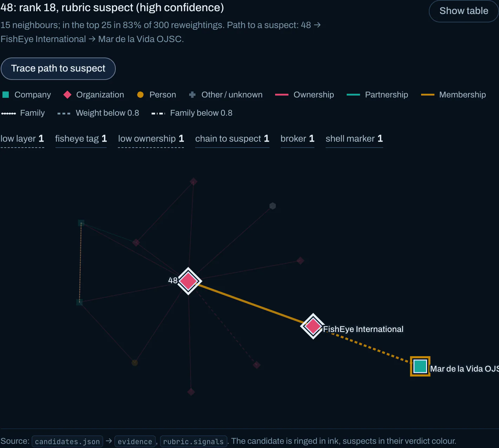
*Figure 3.9. #48, the only high-confidence candidate, with its path to a suspect traced.*

**Confidence.** **Medium** for the layer as a whole, which is statistically clear. **Low to medium** for each individual company, because its strongest evidence is also its least reliable.

---

## 4. MC2: trade patterns, predicted links and renamed traders

### 4.1 Temporal patterns

**The market.** Trade runs one way, into Oceanus: 62 of the 80 largest country-to-country flows start or end there, and Marebak → Oceanus alone carries 1.86 million shipments. Yearly volume peaks in 2030 at 831k shipments and falls to 688k in 2034. Fish (HS 0301–0309, 1604, 1605) holds at 96k–116k a year, so its share rises from 12.7% to 15.6%. Fish is mildly seasonal: an index of 0.84–0.89 from February to April and 1.05–1.08 from July to December.

*Figure 4.1. MC2 story step "Trade runs one way: into Oceanus". Each light is about 200 shipments travelling a current between two countries.*

**Companies.** Shippers are durable: a median span of 59 months, and 4,875 of 12,217 trade for 73–84 months. Receivers are fleeting: a median of 3 months, and 44% appear in a single month. Fish-majority shippers churn more: 2,139 of 4,299 are transient, against 4,740 of all 12,217 shippers.

*Figure 4.2. MC2 story step "Shippers stay lit; receivers flicker out". Each trail is about 50 companies, lit while they trade.*

**Relationships.** Every shipper→receiver pair's monthly series is classified by rules applied in order:

| Pattern | Pairs | Share of shipments | Signature |
|---|---|---|---|
| One-off | 108,067 (44%) | 2.6% | a single month |
| Intermittent | 60,968 | 14.5% | recurring but irregular |
| Short burst | 31,604 | 3.0% | ≤ 6 months, then nothing |
| Fading | 16,729 | 21.9% | second half ≤ ½ of the first |
| Ramping | 13,385 | 16.0% | second half ≥ 2× the first |
| Abrupt stop | 5,994 | 8.3% | stops at full strength ≥ 12 months before the data ends |
| Steady | 4,634 (1.9%) | 32.6% | ≥ 24 months, ≥ 60% of months active |
| Seasonal | 4,426 | 1.2% | ≥ 75% of trade in the same 3 calendar months |

The network is a small core of steady pairs carrying a third of all shipments, ringed by a large fringe of one-off links. Abrupt stops are slightly *rarer* among fish pairs (1.7% vs 2.4%), so an abrupt stop alone is not a sign of IUU fishing. As a cross-check, k-means (k = 8) on 101,115 recurring pairs agrees with the rules at a weighted purity of 0.57.

*Figure 4.3. Steady pairs are 1.9% of relationships but carry a third of all shipments.*

**Successors.** Company pairs with near-identical partner and product profiles mostly *coexist*: they are sister firms. But a second, narrower peak sits at gaps of 0–6 months after a stop, at 1.7 pairs per gap-month against 0.3 just before. That is the signature of a company stopping and a look-alike starting straight afterwards. It is real but small.

*Figure 4.4. Look-alikes mostly coexist; a second peak starts within six months of a stop.*

Confidence: **High** for the aggregate patterns, which are counts over the full graph.

### 4.2 Which predicted links to trust

Each bundle is scored on 11 components against **200 same-size random samples of real 2034 edges**, so small bundles are not punished for noise. Gates override the score: under 25% distinct links, fewer than 20 distinct links, or over 95% exact copies of graph edges force *Unreliable*. Under 50% of links with a weight, or over 5% outside the date window, cap the verdict at *Questionable*.

| Bundle | Score | Verdict | Confidence | Decisive evidence |
|---|---|---|---|---|
| carp | 0.99 | Reliable | High | 165 distinct links, 44% anchored to real records, value bias +0.09 dex, 95% country match |
| herring | 0.95 | Reliable | High | clean; month mix slightly off |
| chub_mackerel | 0.90 | Reliable | Medium | 52% of rows repeat, but 155 distinct links pass every test |
| pollock | 0.88 | Reliable | Medium | 34% repeats; top target 17% |
| salmon_wgl | 0.87 | Reliable | Medium | 57% repeats; 92 distinct links are realistic |
| catfish | 0.56 | Questionable | Medium | no weights, 8.7% of dates in 2035, 49% country match |
| mackerel | 0.52 | Questionable | Medium | no weights, 32% of dates in 2035 |
| salmon | 0.78* | Unreliable | High | 132 links are 13 records |
| cod2 | 0.75* | Unreliable | High | 193 links are 4 records |
| shark | 0.62 | Unreliable | High | 19 distinct records, all copies of graph edges |
| lichen | 0.61 | Unreliable | High | 23 distinct records, all copies; value bias +0.26 dex |
| tuna | 0.34 | Unreliable | High | no weights, 0% anchored, 18% distinct, 22% country match |

\* A gate overrides the score.

**Novelty is two-sided.** An exact match with a real edge (same shipper, receiver, HS code and day) is almost impossible by chance. Some matches anchor a bundle to real records, but all matches mean it adds nothing. The five diverse bundles independently converge on 42–59% matches.

*Figure 4.5. MC2 story step "Twelve predictions; five look like the real graph". Each bundle's links form a grid; repeated rows dim.*

*Figure 4.6. The scorecard. carp and herring pass every test; the gated bundles fail on repetition or missing fields.*

*Figure 4.7. cod2: 193 links collapse to 4 distinct records.*

### 4.3 What the reliable links change

The five Reliable bundles hold 1,015 links, but only **347** are usable (distinct, new and inside the window): under 0.1% of 2034 volume. 261 existing pairs gain links, 58 new pairs appear, and only 15 pairs change pattern. Three things stand out:

- **Three stops were missing data.** Predicted links keep three "stopped" companies trading for five to eight more months: *Chhattisgarh Salt spray ОАО United*, *Bahía Azul Ltd Holdings* and *Okavango River S.A. de C.V. Solutions*. So the successor detector requires 6 silent months, and it marks a pair Unlikely when predicted links revive the predecessor.
- **Verdicts are stable.** All 68 flagged successor pairs (8 Suspect, 60 Possible) keep their verdicts on the augmented graph, and again after the two Questionable bundles (701 links) are added.
- **Hubs get richer.** The predictions densify the core rather than reveal hidden companies. The largest gains go to *hǎi dǎn Corporation Wharf* (33 links) and *Sailors and Surfers Incorporated Enterprises* and *Mar del Este CJSC* (11 each).

*Figure 4.8. Predicted links (dashed) keep three "stopped" companies trading.*

Confidence: **High** that the impact is small. **Medium** on the revivals, which are three cases, each from one bundle.

### 4.4 Companies that fit the IUU pattern

The matcher pairs 2,780 shippers and 3,888 receivers that stop ≥ 6 months before the data ends with companies that start between −6 and +12 months of the stop. Similarity is TF-IDF cosine plus Jaccard on partners and HS codes, so shared hubs count little, and shared partners must actually switch over. Of 872 candidate pairs, 8 are Suspect, 60 Possible, 572 Insufficient evidence and 232 Unlikely.

| Predecessor → successor | Verdict | Confidence | Evidence |
|---|---|---|---|
| receiver −811 → −206 | Suspect | High | fillets (0304); Dec 2032 → Jan 2033; 5 shared shippers supply 78% of −206's trade |
| Beachcomber's Bounty S.A. de C.V. Express → Karelians Limited Liability Company International | Suspect | Medium | Karelians also succeeds five more fish shippers that stopped in 2030 |
| Saltwater Surf Club Sp → Chhattisgarh GmbH & Co. KG Sea spray | Suspect | Medium | dried fish (0305) only; all 3 shared partners switch |
| Asveja Limited Liability Company → Marine Mavericks Marine biology | Suspect | Medium | molluscs (0307); 95% of the successor's trade is inherited |
| receiver −812 → −556 | Suspect | Medium | prepared crustaceans (1605); 5 shared shippers |
| receiver −513 → −690 | Suspect | Medium | identical partner set |
| The Salty Dog Corporation → Gulf of Guinea Sp | Suspect | Low | 13-shipment predecessor |
| Estrella del Sol CJSC → Mandalore S.A. de C.V. Logistics | Suspect | Low | 12-shipment predecessor |

*Figure 4.9. MC2 story step "One buyer goes dark, another lights up". −811's shipments end in December 2032, and five of its shippers arc down to −206.*

*Figure 4.10. The −811 → −206 handover: monthly trade mirrored around the stop, and each shared shipper's last trade with the old id and first with the new.*

*Figure 4.11. Six fish shippers stop in 2030, and Karelians starts in November, trading with their partners.*

Confidence: **Medium** overall. Each pair has only 3–5 shared partners, there is no ground truth, and 24 high-similarity pairs proved Unlikely because their partners did not switch.

---

## 5. MC3: the giant network is a name collision

Every link joins a company to a person. A *business group* is a connected component. There are 13,587 of them, and the giant component is split by seeded Louvain into 86 slices for ranking.

### 5.1 Anomalies

**Name collisions create the giant component.** People are identified only by name. Of people linked to one company, 21.9% carry one of the 50 most common surnames; of those linked to five or more, 92.6% do. The giant component holds 7,093 nodes (1,506 companies and 5,587 people). Remove the 651 multi-company people with common surnames and it falls into 1,083 pieces: 306 nodes stay connected, and the next largest piece holds 288. Remove 651 *random* multi-company people instead, and 495–1,918 nodes stay joined across 10 trials. Confidence: **High**.

*Figure 5.1. MC3 story step "One business group of 7,093". Joined naively, the register forms one connected galaxy.*

*Figure 5.2. Mid-morph: the galaxy breaking apart as the 651 common-surname people are removed.*

*Figure 5.3. MC3 story step "Take them out and the galaxy breaks". 1,083 pieces remain, and 306 nodes stay joined.*

*Figure 5.4. MC3 story step "Chance does not do this". Random removals leave 495–1,918 nodes joined, never 306.*

**The other anomalies:**

- **Ownership fragmentation.** 107 companies have 20 or more beneficial owners and 38 have 30 or more. *Vespuci Sandbar Sp Brothers* has 119. 82 groups carry this flag. Confidence: **High**.
- **Serial owners with uncommon names.** These are the person links least likely to be collisions. *Anna Wheeler* owns 7 companies and *Jason Carrillo* is the contact for 6 of them (BG00148, the top anomaly of 2,347 scored groups). Confidence: **Medium**.
- **Registry inconsistencies.** 112 groups contain a distinctive company name registered in several countries. 166 groups contain a fishing-named firm that declares an unrelated product (274 companies). *Adriatic Squid* has both "Footwear" and "Seafood" records. Confidence: **Medium**.
- **Data-generation artefacts, not IUU signals.** 1,391 names have a stripped word ("Greek ermen"); 113 product texts end in "source: freelance researcher"; 11,420 Faker-style names all sit in country "ZH".

Groups with three or more nodes are scored by an Isolation Forest over 16 size-normalised features. Each score is explained by robust z-scores and 8 rule flags.

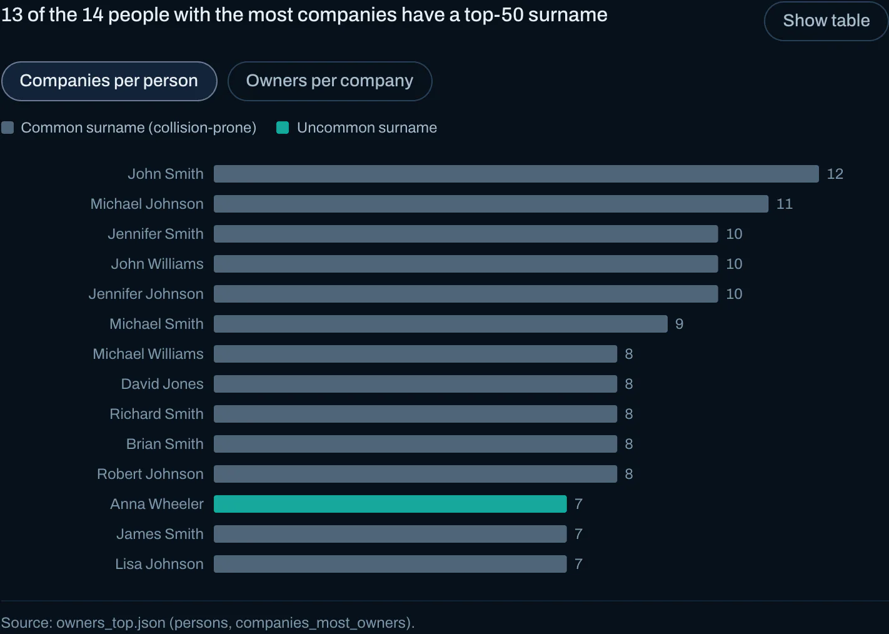
*Figure 5.5. 13 of the 14 people with the most companies carry a top-50 surname. Anna Wheeler is the exception.*

### 5.2 Grouping similar businesses

Product text is classified into *fishing* (1,043), *adjacent* (623), *other* (2,209) and *unknown* (12,822). Fishing words in names are a second, independent signal on 1,201 names, including pinyin such as *yú* and *diao yu*.

Because 77% of companies have no product text, there are two similarity spaces. The **text space** (3,875 companies) is LSA of TF-IDF terms with weight 0.8, plus structural features with weight 0.2. The **structure space** (12,822 companies) uses structural features only. k is chosen by silhouette × bootstrap stability, which gives k = 20 for text and k = 13 for structure. Four text clusters are seafood segments (T09 species, T12 processed, T16 generic fish products, T20 frozen): 861 companies, each cluster at least 84% fishing.

*Figure 5.6. MC3 story step "Similar firms, by what they sell". The four seafood clusters are lit on the text map.*

### 5.3 Confidence in the groupings

Three independent measures are used: cohesion (within-cluster cosine and silhouette), stability (clusterwise Jaccard over ten 80% subsamples), and each company's margin between its nearest and second-nearest centroid. *High* needs stability ≥ 0.85 and silhouette ≥ 0.25; *Medium* needs stability ≥ 0.6 and silhouette ≥ 0.05. The text space has 2 High, 10 Medium and 8 Low clusters (mean stability 0.60). The structure space has 8 High, 2 Medium and 3 Low (silhouette 0.63, mean stability 0.82), but it is easy to cluster rather than rich. T12 (processed seafood) is solid, while T16 (generic "fish products") blurs into its neighbours.

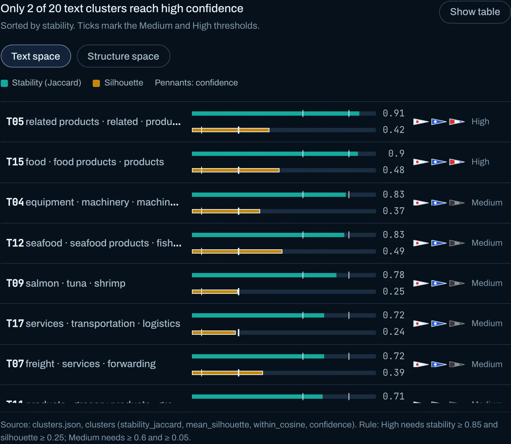
*Figure 5.7. Only 2 of the 20 text clusters reach high confidence.*

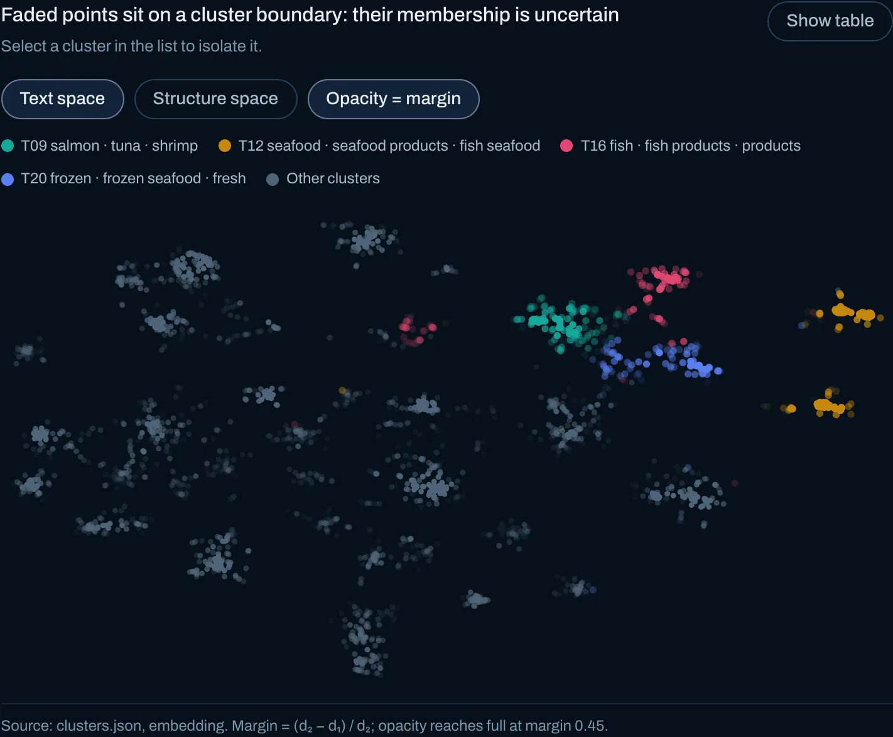
*Figure 5.8. Opacity encodes margin, so companies on a cluster boundary fade.*

### 5.4 Are anomalous companies fishing illegally?

Anomaly and fishing overlap only moderately. Of the 119 most anomalous groups (the top 5%), 13% reach a fishing relevance of 0.5, against 17% of the rest. Anomaly alone does not point to fishing, so the ranking combines them: 0.45 × anomaly percentile + 0.30 × flag score + 0.25 × fishing relevance. The product-text share inside fishing relevance is shrunk towards the corpus rate of 26.9%. Of the 30 ranked groups, 2 are Suspect, 20 Possible, 7 Insufficient evidence and 1 Unlikely.

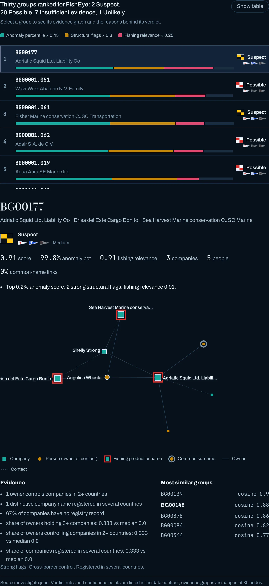
*Figure 5.9. Thirty groups ranked for FishEye, with BG00177 open.*

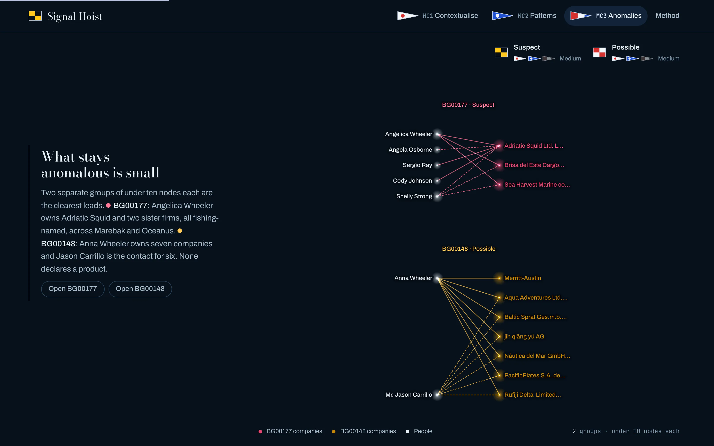
*Figure 5.10. MC3 story step "What stays anomalous is small": BG00177 and BG00148.*

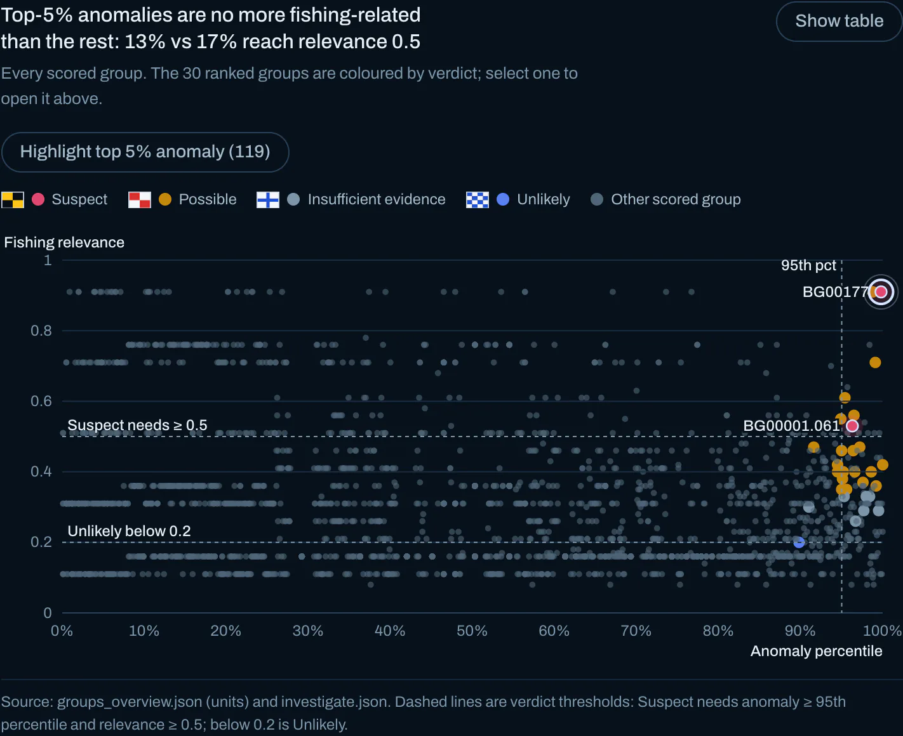
*Figure 5.11. Top-5% anomalies are no more fishing-related than the rest.*

Confidence: **Medium** that the Suspect and Possible groups are a better-than-random lead list. **Low** that any single group is engaged in IUU fishing.

---

## 6. Verdict summary

### MC1: the tipped entities

| Entity | Verdict | Confidence | Why |
|---|---|---|---|
| 8327 | Suspect | Low | Strongest structural signature (5.0 points), but almost all of it rests on edges weighted 0.12–0.32 |
| 979893388 | Suspect | Medium | 99.8th-percentile hub; owns Oceanfront Oasis through a strong edge; evidence on strong edges and structure |
| Mar de la Vida OJSC | Possible | Low | Tied to the layer only by a weak FishEye membership (0.46) |
| Oceanfront Oasis Inc Carriers | Possible | Low | Thin subsidiary of 979893388 with a weak FishEye tag (0.45) |
| #48 (candidate) | Suspect | High | FishEye tag on a 0.95 edge; ownership chain to 979893388 |
| #903311212 (candidate) | Suspect | Medium | Rank 1; FishEye-tagged hub one hop from 979893388 |

### MC2: successor pairs and bundles

| Entity | Verdict | Confidence | Why |
|---|---|---|---|
| receiver −811 → −206 | Suspect | High | Next-month handover; 5 shared shippers supply 78% of the new trade |
| Beachcomber's Bounty → Karelians | Suspect | Medium | Karelians succeeds six stopped fish shippers |
| Saltwater Surf Club → Chhattisgarh GmbH & Co. KG Sea spray | Suspect | Medium | Dried fish only; all shared partners switch |
| Asveja → Marine Mavericks | Suspect | Medium | 95% of the successor's trade inherited |
| receiver −812 → −556 | Suspect | Medium | Prepared crustaceans; 5 shared shippers |
| receiver −513 → −690 | Suspect | Medium | Identical partner set |
| The Salty Dog → Gulf of Guinea Sp | Suspect | Low | Small predecessor |
| Estrella del Sol → Mandalore | Suspect | Low | Small predecessor |
| carp, herring | Reliable | High | Pass every realism test |
| chub_mackerel, pollock, salmon_wgl | Reliable | Medium | Realistic distinct links, unexplained repetition |
| catfish, mackerel | Questionable | Medium | No weights; dates past the window |
| salmon, cod2, shark, lichen, tuna | Unreliable | High | Repetition, wholesale copying or missing fields |

### MC3: business groups

| Group | Verdict | Confidence | Why |
|---|---|---|---|
| BG00177 (Adriatic Squid and two sister firms) | Suspect | Medium | One owner and one contact across three fishing-named firms in two countries; conflicting registry records |
| BG00001.061 (Fisher Marine conservation CJSC) | Suspect | Medium | 16 companies; one with 26 owners; 62% unregistered; a Louvain slice |
| BG00148 (Anna Wheeler's seven companies) | Possible | Medium | Top anomaly; no products declared, so the fishing link rests on names |
| BG00069, BG00071 | Possible | Low | Multi-country clusters, but tied by common-surname people |
| BG00861, BG00386 | Possible | Medium | Single firms registered in several countries |
| BG00003 | Insufficient evidence | High | Strong structure, no verifiable fishing link |
| BG00016 | Unlikely | Medium | Fishing relevance 0.20 |

---

## 7. Validation

| Check | Where | Result |
|---|---|---|
| Random-edge null (1,000 draws of 88 edges) | MC1 layer | Largest component mean 10.6, max 29, observed 79 (p = 0.001) |
| Ownership share in layer vs graph | MC1 | 66% vs 18% (p = 2e-23) |
| Suspects inside the layer | MC1 | 3 of 4 (p = 5e-5) |
| Degree-matched suspect sets (199) | MC1 distances | 8% are at least as close: closeness is mostly degree |
| Louvain across five seeds | MC1 communities | 0.33–0.63 retention; no stable shared community |
| Leave-one-out | MC1 candidates | Held-out suspects rank 11–51 of 1,210; degree ranks 7–528 |
| 300 random reweightings | MC1 candidates | Mean Spearman 0.98, min 0.89 |
| Feature ablation | MC1 candidates | Low-weight feature essential (8 of 25 kept); others 19–24 |
| 200 same-size samples of real 2034 trade | MC2 bundles | Distribution tests scaled to bundle size |
| k-means (k = 8) vs rules | MC2 patterns | Weighted purity 0.57 |
| Re-detection on augmented graphs | MC2 successors | 68 of 68 flags unchanged, also with Questionable bundles |
| Random-person removal (10 trials) | MC3 giant | 495–1,918 nodes vs 306 for common surnames |
| Bootstrap stability (ten 80% subsamples) | MC3 clusters | Mean 0.60 (text), 0.82 (structure) |
| Determinism | All pipelines | Byte-identical outputs across runs |

---

## 8. Limits

- **No ground truth.** Every verdict is a ranked lead with stated confidence, not an accusation.
- **Undocumented semantics.** MC1 edge weight is read as extraction confidence, and ownership direction is unknown. Both are assumptions.
- **Hand-set rubrics.** Weights and thresholds are judgement calls. They are published with the scores so they can be challenged.
- **Small evidence.** MC2 successor pairs rest on 3–5 shared partners, and stops late in 2034 cannot be told apart from missing data.
- **Identity by name.** In MC3, collisions inflate shared control. A keyword fishing classifier misses euphemisms, and 77% of companies have no product text.
- **Louvain slices.** Groups cut from the giant component have boundaries that depend on community detection.

---

## 9. Reflection

The hardest part of each challenge was deciding what to trust. In MC1, extraction errors formed structure that looked like evidence. In MC2, two HS-code formats would have silently zeroed out every chapter-03 fish link in the bundles. In MC3, common names like "John Smith" fused 1,506 companies into one group. In each case, a null model turned a suspicion into a measurement. Null models also reversed early conclusions: raw cosine had rated catfish and mackerel reliable, and a single clustering space reported a reassuring but hollow silhouette of 0.49.

The open-source Python stack and D3 were enough. A data dictionary for MC1's weights and edge directions would have helped most. So would unique person identifiers in MC3, documentation of the MC2 currency and HS conventions, and even a few labelled cases to calibrate the rubrics. With more time, the next steps would be to resolve people by co-occurrence, validate the fishing labels against a hand-labelled sample, test how sensitive the rankings are to their weights, and link entities across the three graphs.

---

*Hours spent:* [AUTHOR TO FILL: hours] · *Permission to post in the Visual Analytics Benchmark Repository:* [AUTHOR TO FILL: Yes / No] · *Video:* Not provided
